

  

<h1 align="center">B4RCS: Bots for Arcs</h1>

<b><a href="https://oz10.github.io/ARCS_Solo/">Open B4RCS</a></b>

B4RCS is a free web app that plays bots for the board game **Arcs**, so you can play solo or fill empty seats at the table. You play the real game on the table, and the app decides what each bot does: which card it plays, whether it declares an ambition, what it spends, who it battles and which dice it rolls.

The app keeps a copy of the board: where every ship and building is, in each system. Bots use it to plan exact moves, such as *"Move 5 ships 2h → 3a"*, and you move their pieces for them on the table. At the end of each round, you check the app's board against the table. The app keeps track of everything else too: each bot's hand, resources, Guild cards, the Court and the score.

It's made for a phone in portrait, works in landscape too, and can be installed so it opens like an app and works offline.

> B4RCS covers the base game, the Leaders & Lore mini expansion and, still being tested, the Blighted Reach campaign. It isn't an official Leder Games product, and you'll need your own copy of Arcs (and the expansions you play with) to play.

## Contents
- [Getting started](#getting-started)
- [Starting a game](#starting-a-game)
- [Leaders & Lore](#leaders--lore)
- [The Blighted Reach campaign](#the-blighted-reach-campaign)
- [The screen](#the-screen)
- [Your turn](#your-turn)
- [A bot's turn](#a-bots-turn)
- [What you handle for the bots](#what-you-handle-for-the-bots)
- [Battles](#battles)
- [Building](#building)
- [The Court](#the-court)
- [Guild and Vox cards](#guild-and-vox-cards)
- [Drawing, declaring and seizing](#drawing-declaring-and-seizing)
- [Ending a turn and a round](#ending-a-turn-and-a-round)
- [Undo, Save and Load](#undo-save-and-load)

## Getting started
Open **https://oz10.github.io/ARCS_Solo/** in your phone's browser.

To install it, use the browser's menu: in Chrome on Android, tap **⋮** then **Install app**. On an iPhone, tap **Share** then **Add to Home Screen**. Once installed, it opens in its own window and works without a connection.

Your game is saved on your phone as you play, so you can close the app and carry on later.

## Starting a game
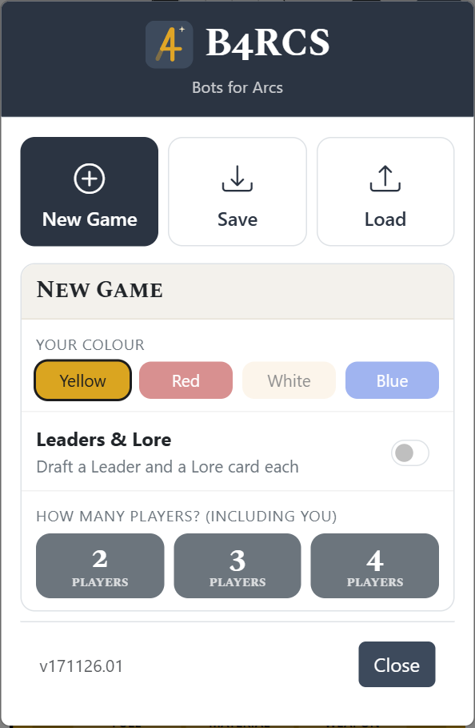

Tap **Options**, then **New Game**.

1. **Human players:** how many human players are at the table, from 1 to 4. Human players take the first seats (Players 1, 2…), and the rest are bots. With more than one, you pass the device at each human player's turn. Their hand is covered by frosted glass until they tap **Show my hand**, and covered again when play moves on, so nobody sees anyone else's cards. With 4 human players there are no bots, so Bot difficulty is hidden.
2. **Colours:** each human player chooses a colour. A colour another human player has taken is faded out. The bots take the colours that are left.
3. **Leaders & Lore:** turn on **Play with Leaders & Lore** to play with the mini expansion (see [Leaders & Lore](#leaders--lore)).
4. **How many players:** 2, 3 or 4, counting human players and bots, and at least as many as there are human players. Below it, turn on **Blighted Reach campaign** to play the campaign instead (see [The Blighted Reach campaign](#the-blighted-reach-campaign)).
5. **Start game:** the app deals everyone's hands. A random player starts with the initiative, as the rulebook says, and the ★ shows who. If a game is being played, it asks first, as Undo can't bring it back. To keep it, save it first.

 

6. **The Court:** add the cards dealt to the Court market (4, or 3 with 2 players), or tap **Deal for me** and take the same cards from your Court deck. Bots use this to choose what to secure and influence. You can skip it, but their advice will be more general.

 

7. **Set up the board:** tap **Deal a setup card** for the app to choose one, or pick the setup card you drew from the list. The app places everyone's starting pieces on its board and fills in their panels, including the 2 starting resources. It then lists where each player's pieces go, by system (such as *3h: 1 city, 3 ships*), and which clusters are out of play. Set up the table to match and tap **OK**. With Leaders & Lore, the pieces come from each Leader.
 

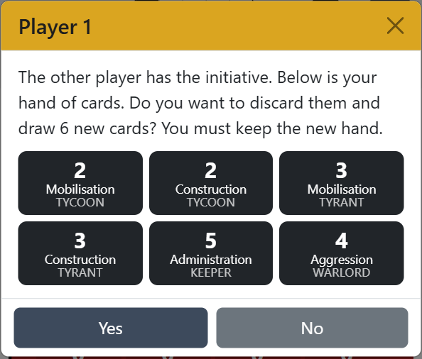

8. **The mulligan (2 players):** the player without the initiative may discard their hand and draw 6 new cards. If that's a human player, the app shows their hand and asks (with more than one human player, under the frosted glass until they tap). Then Round 1 begins. In later rounds it asks once the new hands are dealt, before the round begins.

 

### Bot difficulty
In **Options**, under New Game, choose how well the bots play, from **1 (Easy)** to **5 (Hard)**. It applies to every bot from its next decision, so you can change it during a game.

- **1 Easy:** makes plenty of mistakes and takes big gambles. It leaves every prelude spend to you.
- **2 Relaxed:** makes the odd mistake, and plays a little loosely.
- **3 Normal:** plays well, with some surprises.
- **4 Tough:** rarely strays from its best move, and declares an ambition or seizes the initiative when it works out it would win.
- **5 Hard:** always takes the best move it can work out, and does nothing on a whim. Its prelude spends are still ticked for you to check.

Every difficulty plans from the app's board, so keep it matching the table.

## Leaders & Lore
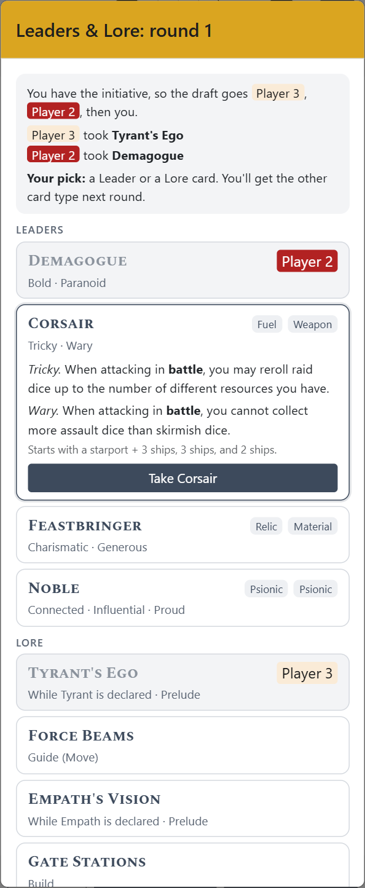

**The draft:** after the Court, everyone drafts as the rulebook says. There's a row of Leaders and a row of Lore cards, one more of each than there are players, and players pick in reverse turn order. You take one card type in the first round and the other card type in the second. Tap a card to read it, then **Take** it. The bots pick at random.

**Setting up:** the app sets each player up from their Leader: their starting resources, and what to place in systems A, B and C. An Archivist also chooses 2 extra Lore cards. Each player's Leader and Lore are shown above their Guild row. Tap one to read it.

 

**What the app does for you:**
- **Scoring:** the Elder, Warrior, Archivist and Noble score as their cards say, and the scoring window says why. The Fuel-Drinker discards its Fuel when Tycoon is scored.
- **Declaring:** when someone declares an ambition, the app carries out Ambitious (Upstart), Generous (Feastbringer), Bold (Demagogue) and Connected (Noble). When it's you, a window asks what you'd like to do. Bots do it themselves, and their turn window says what they did.
- **Securing:** a Demagogue can't secure a Guild card with only 1 of its agents on it.
- **Battles:** extra dice and dice limits (Rebel, Corsair, Raider Exosuits), raid limits (Hidden Harbors, Keeper's Trust, Keeper's Solidarity), intercepts (Agitator, Mirror Plating, Railgun Arrays) and no Ransack against the Elder. The results list anything else to do, such as repairs.
- **Ancient Holdings:** its extra resource slot is included when the app says which slot to put a resource in.

**How the bots use them:** a bot's plan has a short line under any step its Leader or Lore changes, such as *Rebel, Disorganized: no more than 2 ships at a time*. Bots lean towards the action their Leader improves when they Copy or Pivot, offer Lore actions in place of normal ones in a **Guild and Lore actions** window, and use Lore in their prelude, such as discarding a card to clear an Outrage.

**What's left to you:** anything that depends on the board, such as where Force Beams moves ships or which planet Mythic changes. The hints say what the bot may do. You decide where it makes sense.

## The Blighted Reach campaign
The campaign is played over three Acts of up to three chapters each, with the bots playing every Fate except the Magnate. It's new, so expect rough edges, and please [report](https://github.com/OZ10/ARCS_Solo/issues) anything that doesn't match the rules.

**Choosing Fates:** with the campaign switched on, choose how Fates are given out. **Deal 2** deals two and you (or the bot) choose one. **Pick** lets you choose any "A" Fate, to try a particular one. At the start of Acts II and III, each player keeps their Fate or takes a new one.

**Setting up:** the setup window lists each step to do on the table, with the dice already rolled: the Imperial clusters, Free cities, Blight, the Imperial Council and the starting Policy in Act I; each player's Fate setup and the new Blight in Acts II and III. Tick each step as you go.

**The panels:** each player's panel shows their Fate (tap it to read the card), their title (**Regent** or **Outlaw**, tap to change it), the First Regent, their objective marker and Favors. The Imperial Trust has its own panel.

**During a chapter:** Event cards are shuffled into the action deck. When one is played, the app rolls the event die and walks through the end of round: the Imperial Council, Summits, then Crises or Edicts, with the First Regent's Policy. Fate cards are added to the Court and Guild rows like any other card.

**How the bots play:** a Regent bot follows the Empire's laws (moving and battling alongside Imperial ships, and leaving Rival Regents alone where there are Imperial ships) and would rather battle an Outlaw. Bots value the Imperial Council, and as First Regent they choose whether to enforce or change the Policy, and whether to make a Rival Regent with no agents left an Outlaw. When a bot may call a Summit, it weighs leaving the Empire (its Fate, stealing from the Imperial Trust, what the Edicts take) against staying (being First Regent, the Imperial ships), and says why. It also revives the Empire when there are no Regents, and petitions the Council when it wants it again. Bots battle the Free States, the Blight and, as Outlaws, the Empire: when one is worth it, the bot asks whether it's in reach, and the Battle window starts with it chosen. Each bot plays towards its Act I objective and uses its Fate cards, and its turn window has a section explaining what its Fate wants this turn. Under **Playing towards it** it lists what its Fate changes. Most Act I objectives pay for winning ambitions under a condition (as First Regent, as an Outlaw, with Golems, without Outrage): while it holds, the bot declares more readily and leads with the ambitions it would win. Fates with goals on the board plan for them: the Founder moves to take systems, the Caretaker goes after Golems (it asks whether it controls one, and then Awakens them), and the Admiral battles alongside Imperial ships.

**Act II Fates:** each bot plays towards its Act II objective too. Its turn window lists what that changes under **Playing towards it**: which resources it keeps or spends, the battles it won't fight, where it moves, the Court cards and Policy it wants, and the ambitions it leads with. Steps its Fate shaped are tagged with the Fate's name. Fate tokens the app can't see, such as Banners, Clues, Hammer Fragments and Seats, are listed under **On the table**. A bot Believer asks once a chapter whether each declared ambition has an Ideal marker.

**Act III Fates:** bots play towards their grand ambitions, or a "C" Fate's final objective, in the same way. Some never declare an ambition their Fate needs no Rival to win, and chase it once a Rival declares it; the Judge stops adding to an ambition once it's tied for first.
- **Edenguard and Blightkin:** while the Guardian or the Naturalist is in play, the new ambition has its own chip in the top bar and a button in the Declare window, under the ambition it replaces. The app can't see the planets or the Blight, so you enter the counts in the scoring window. A bot Guardian or Naturalist leading with a Tycoon or Empath card asks whether it controls the most, and declares the new ambition on a Yes.
- **The Pathfinder:** a bot asks each turn whether it controls the Portal, and moves its Flagship there if not.
- **Fate card actions:** in Acts II and III a bot offers its Fate cards' own actions in its prelude and Guild actions window: Claim Fief, Building Bunkers, Repair Hammer, Prepare, Break World, Spawn, Seed, Incite Revolt, Planting Banners and Uncovering Clues. It ticks Claim Fief and Building Bunkers itself; the others depend on the map, so tick them if they can be done.
- **The Conspirator:** a bot places a Conspiracy instead of a marker. Put any Conspiracy token face down without looking at it: the app keeps who it's for secret, reveals it after scoring and moves the objective. To guess one, tap **Foil a Conspiracy** on its panel.

**Objectives:** at the end of each chapter, a window lists the objective markers that moved and why, and asks you anything the app can't see, such as how many systems a bot controls. Move the markers on the table to match. In Act III, "A" and "B" Fates are asked which grand ambitions they fulfilled and gain the Power for them, and a "C" Fate that completes its final objective with Power wins the campaign.

**Between Acts:** the Intermission works out everyone's Power for the next Act. Each step between Acts is saved as it's reached: the Intermission, choosing Fates (with the same Fates dealt), the Fates revealed, and the next Act's setup. If the app is reloaded partway through, it carries on from that step, and nothing is done twice. After Act III, the player with the most Power wins, unless someone completed their final objective.

**Deals with the bots:** in any Summit, whoever called it, the Negotiations section has a **Deal with Player N** button for each bot.
- **Building the deal:** what you give and what you want from the bot, from the Negotiation actions: Transfer Asset, Promise Favor, Cede Control, Delegate Authority and Invite to Empire.
- **The bot's answer:** it weighs what it gets against what it gives, and accepts, makes a counter-offer, or refuses, with its reasons. It asks more of the player leading on Power, and remembers deals made with it.
- **After a deal:** the app updates the panels and lists what to move on the table.

**The bots' own deals:** when a Summit opens, whoever called it, each bot may offer one deal. A bot with nothing to offer says why. It asks for a resource it's chasing and gives what it can spare. You can accept, make a counter-offer, or say no thanks. Deals between two bots are settled straight away and listed. A bot that calls a Summit also calls in Favors it holds (your agents on its Fate card) to force you to give it what it's chasing. For a resource, the app asks the raid cost shown on that slot.

**The Magnate:** bots can now be dealt it.
- **Merchant League:** the resources it gains when it declares an ambition are shown on its panel. They can only be given away in Summit deals, and its Crisis empties them.
- **Its objective:** the app moves it for each resource or Favor a Rival gives the Magnate, and for each export of 3 resources. A human Magnate has an **Export to the Galactic Core** button in the Summit. In Act III they play their usual game rather than chasing their grand ambitions. Faithful cards played from a hand, Flagships and Fate tokens are handled on the table.

## The screen
- **Top bar:** the round and turn, the ambitions declared this round with their marker values, and **Options** (the gear). Tap an ambition to see how it's won and what it's worth, and to declare it for any player, bots included: for example after a Surpass with Galactic Bards, or with Populist Demands.
- **Announcements:** at the start of each round and turn, a card says who leads. It closes by itself, or when tapped.
- **What happened:** everything else the app tells you, such as a battle's results or an ambition declared, is listed above the turn bar and at the top of the turn window, newest first. Each stays until you close it with **×** or tap **Clear all**. The newest 3 show; tap **+N earlier** for the rest.
- **Player panels:** one per player in their colour. Tap a player's name to open or close their panel. The ★ shows who has the initiative.
- **Panel sections:** each panel's **Resources** (with Outrage), **Board** and **Guild cards** sit under a header you tap to open or close. A closed header shows small counts, such as the resources held and the ships on the board. The hand and **Play Card** always show. In **Options**, **Panel sections** chooses how they start:
  - **All open:** always open.
  - **Turn** (the default): closed until the player has played their card, then open until the next player's turn.
  - **All closed:** open one by tapping its header.

  A closed section opens when the app changes it, such as after a battle or scoring.
- **Tiles:** each panel has **−** and **+** tiles for resources, Captives, Trophies, Power, ships and starports on the board, and cities on each planet type. Resources and cities show only an icon, after the game's tokens, and the ambitions in the top bar use the same ones. Keep these matching the table. Bots use them to make their choices, and they're filled in for you when the app knows what happened, such as after a battle. Ships, starports and cities follow the app's board, so correct those with **Check the board** in **Options**: a change on the tile alone is replaced the next time the board changes.
- **Outrage:** under the tiles, the resources that player is Outraged in are marked red. It's filled in when a city is destroyed or Outrage Spreads is played, and you can tap one to mark or clear it. A bot won't spend an Outraged resource in its prelude.
- **Guild row:** the Guild cards each player holds. Tap **+** to add one, or tap a card to read it or remove it.
- **Footer:** **Undo**, **Next Turn** and **Next Round**, with the cards played this turn listed above them.

## Your turn
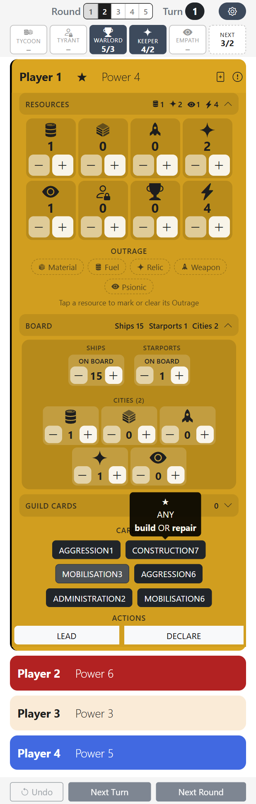

Your hand is listed on your panel. Tap a card to see its pips, ambition and actions, then choose how to play it:

- **Leading:** **LEAD**, or **DECLARE** to declare the ambition on it.
- **Following:** **SURPASS**, **COPY** or **PIVOT**.
- **CLAIM:** turn this on to also seize the initiative with a card played face down.

 

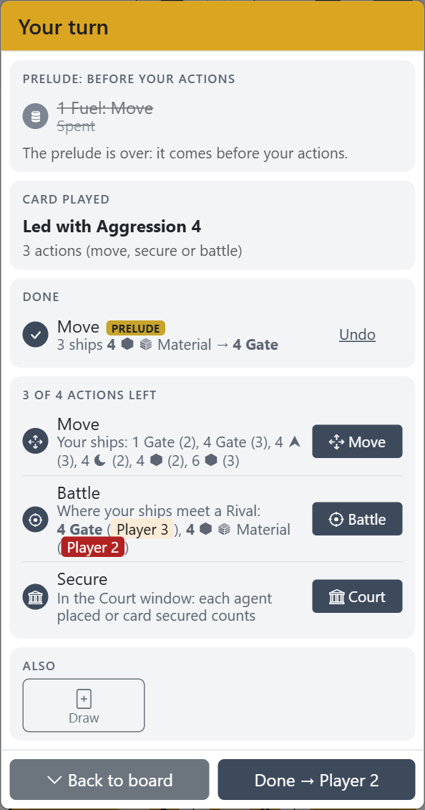

**Your turn window** then opens, like a bot's. It counts your actions, such as **3 of 3 actions left**, and lists each kind your card gives you with a button and what's possible on the board, such as *"Where your ships meet a Rival: 2g (Player 3)"*. Take the same action as many times as your card allows. Each one you do on the table, do in the app too:
- **Move:** choose where from and where to (only the systems your ships can reach, Catapult included) and how many fresh and damaged ships. If the ships pass through other systems, the window shows the route, with **−** and **+** for any you left on the way, and **Choose the route** if you went another way. The button says what goes on the board, such as *"Move 5 ships 3c → 5a, leaving 2 at 3g"*.
- **Build, Repair and Tax:** only what the board allows: a city or starport on a planet with an empty slot where you have a piece (damaged if a Rival controls it), a ship at each starport once a turn, your damaged pieces, and your cities or a Rival's city in a system you control (which also captures one of their agents). Tax adds the resource to your panel.
- **Battle:** opens the Battle window, starting on a Rival you share a system with, and the counts from the board. **Where** lists the systems you could battle in. When it updates the panels, it counts as an action.
- **Secure and Influence:** **Court** opens the Court window, and **Done it** counts the action.

Each action you've taken is listed under **Done**, with **Undo**, which takes it off the board and gives the action back. When none are left, the buttons are greyed out. **Prelude** lists what your resources and Guild cards can do before your actions. **Spend** takes the resource off your panel and adds its action, such as a Move for a Fuel, marked **PRELUDE**. **Use** does the same for a Guild card. Anything your card doesn't have is under **Also**, with **Draw**. Tap **Done** when you've finished. **Back to board** shrinks the window to a bar, as on a bot's turn.

 

## A bot's turn
Tap the bot's **Play Card** button.

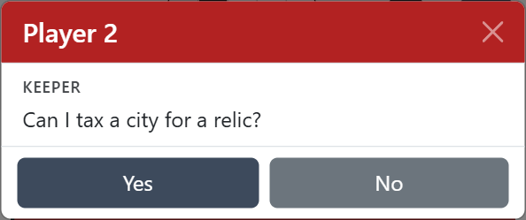

**Its questions:** the bot works out most things from the app's board: how big a fleet it can bring to a battle, where it can build, which cities it can tax and which Rivals it can reach. It only asks about what the board doesn't hold, such as *"Can I reach a Rival's relic city this turn?"* when that depends on a card. Answer honestly from what you see on the table.

 

**Its prelude:** before its actions, a bot may offer to spend resources or use Guild cards. The window shows the card it played and its plan without them. Where the app knows enough, such as a Court card it can secure or what you've told it this turn, the bot decides for itself: those are already ticked under **Its decisions**, each with its reason. Untick any that don't make sense on the table. The rest are under **Your call**: tick the ones that make sense on the board. The app updates its resources for you.

 

**The turn window** then shows the whole turn:

- **Prelude:** what it spent first.
- **Card played:** what it played, and the actions it gives.
- **Plan:** numbered steps with the reason for each, naming the systems: *"Move 5 ships 2h → 3a (to set up the Battle)"*, *"Battle Player 3 at 3a"*, *"Build a city at 4a (Relic)"*, *"Tax its relic city at 2h"*, *"Repair a damaged ship at 1g"*. A bot moves to set up its battle, to defend a city a Rival's fleet could reach, to take control of a Rival's city, to build, or to guard a city with no ships. Steps that need a window have a button beside them, such as **Battle**, **Build** or **Court**. The plan is advice: see [The plan is advice](#the-plan-is-advice).
- **Also:** anything else it may use this turn.

Carry out the steps on the table, then tap **Done** to move on to the next player. **Done** also makes the bot's moves, builds and repairs on the app's board.

 

**Back to board** shrinks the window to a bar above the footer, so you can tap the tiles while still seeing the plan. Tap **Open** to bring the window back. It also comes back by itself when you finish a battle, build or Court action.

When a bot gains a resource, a box above the bar says **which resource slot to put it in**, high keys first if it wants to keep it safe from raids. It stays until you close it or the turn ends. A bot with no room for a resource it steals or is given returns the one it needs least, and says so.

 

## What you handle for the bots
The app plays each bot's cards and makes its choices, but it can't see or touch the table. You're its eyes and hands:

- **Its pieces:** move its ships, and place or remove its buildings, agents and resources on the table, where the plan says.
- **Its panel:** the ships, starports and cities on its panel come from the app's board. The app fills in its resources when it knows what happened, such as after a prelude, a battle, a build, the Court or scoring. For anything it can't see, such as a tax, you update the tiles.
- **Its answers:** answer its Yes/No questions from what you see on the table.
- **The board check:** at the end of each round, the **Check the board** window goes through each cluster in play, listing every player's ships and buildings in each system. Correct anything that doesn't match the table with **−** and **+**, **+ Ships**, **+ City**, **+ Starport** and **×**, then tap the next cluster and **Done**, or **It all matches: done**. This catches anything that didn't go through the app, such as a Leader's or Guild card's effect, or a step you skipped. You can open it any time from **Options**, **Check the board**.
- **Its dice:** roll the dice it chooses, then enter what's left.
- **The Court:** when a card leaves the market, add its replacement. Do anything a window asks you to update yourself.

### The plan is advice
A bot plans its turn from the app's board, which can drift from the table between board checks. If a step doesn't make sense on the table, such as a battle it can't reach or a card that's no longer worth securing, skip it or use that action for something better. Play the bot the way a sensible player would.

The plan is set when the turn window opens and doesn't change as you work through it, so you can follow it step by step.

## Battles
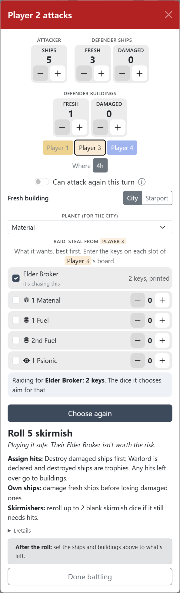

Tap **Battle** in the turn window, yours or a bot's.

For a bot:
1. **Defender:** it starts on the Rival it wants to fight, and says why.
2. **Counts:** filled in from the app's board for the system in the plan: the ships and buildings there, and the planet type. Correct them if the table is different.
3. **Raid:** if the bot can raid, choose what it's after and enter the keys shown on that slot of the defender's board. Raid dice need a building in the system, or a defender with no buildings on the board at all. The app knows that from the panels and says so.
4. **Choose dice:** tells you which dice to roll and how to assign the hits, including which building to hit first and why. The attacker chooses where its hits go. It weighs up the risk to its ships, what destroying a city would cost in Outrage, any Ransack, and what the defender loses, such as their last starport. **Details** shows the odds.
5. **After rolling:** set the counts to what's left. Attack again, or tap **Done battling**.

The **(i)** beside *Can attack again this turn* explains when to use that switch.

 

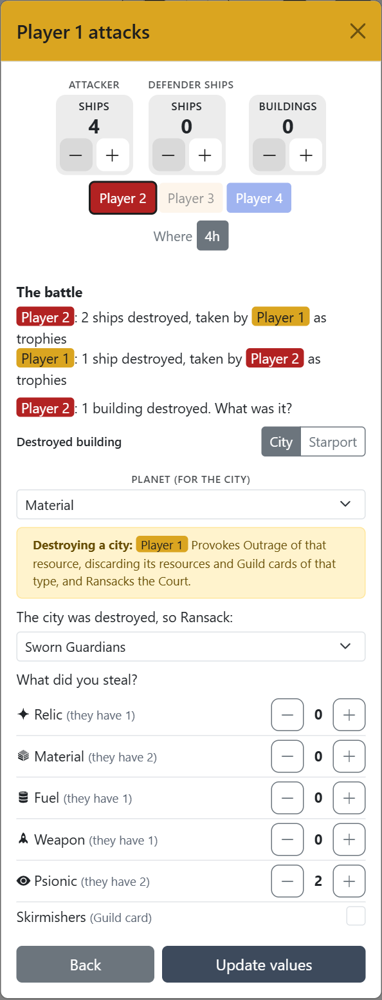

**Done battling** shows the results: ships destroyed and taken as Trophies, which buildings were destroyed, Outrage and Ransack, and anything stolen. Check them and tap **Update values** to update both players' panels. For a bot's battle, the losses go on the app's board too.

For your own battles, the window doesn't choose dice. It keeps count while you roll, then updates the panels in the same way. For what you stole, use **−** and **+** for each resource, as you can take more than one of a kind, and tick any Guild card.

 

## Building
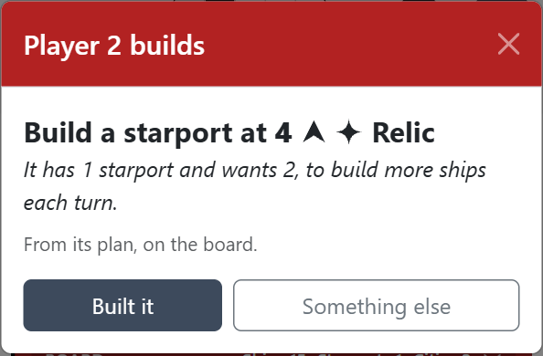

Tap **Build** in a bot's turn window. The app has already chosen from its board what to build and where, and says why: a city, a starport or a ship. Bots like 2 starports, and 3 from round 3, so they can build more ships each turn. Tap **Built it** to put it on the board and update its panel, or **Something else** if it can't be built on the table.

 

## The Court

Tap **Court** in the turn window, yours or a bot's. It lists the cards in the market with everyone's agents on each in their colours. Use **−** and **+** to keep the agents up to date, **×** to remove a card, and the list at the bottom to add its replacement.

For a bot, the top line says what it would secure or influence. **Secure** takes a card the player can secure, captures any Rival agents on it, and moves it to their Guild row. When a bot secures a Vox card, the app tells you what it does with it.

If a card leaves the market, the turn window reminds you to add the replacement.

In a campaign, while someone holds Guild Investigators, a Court card with no agents has a list to **attach** a Guild card from the discard pile (Recover). The attached card shows under it, goes with it when it's secured, and makes it worth more to the bots. The Imperial Council's row has an **In Session / Decided** switch, for when it changes on the table without the app.

 

## Guild and Vox cards

Tap a card in a player's Guild row to read it or remove it. Tap **+** to add one, which removes it from the market. For a bot, the list includes the Vox cards so you can record what it secured.

Bots use their Guild cards themselves: they offer them in their prelude or instead of actions, and they're included in battles, scoring and the cards they choose. Your **Farseers** card has a **Use its prelude** button, and when you declare with it, you choose one Rival's hand to look at and swap with.

 

## Drawing, declaring and seizing

The icons on your panel's header are:

- **Draw:** add a card to a hand, either one played this turn (the Unions) or the bottom card of the discard pile (Farseers, Call to Action). Bots have this icon too.
- **Seize:** seize the initiative, for example with a Vox card.

To declare outside your turn's card, tap the ambition in the top bar. Bots seize and declare by themselves.

 

## Ending a turn and a round
When everyone has played, tap **Next Turn**. When nobody has cards left, tap **Next Round**. Before the next round starts, the app asks you to check its board against the table (see [What you handle for the bots](#what-you-handle-for-the-bots)).

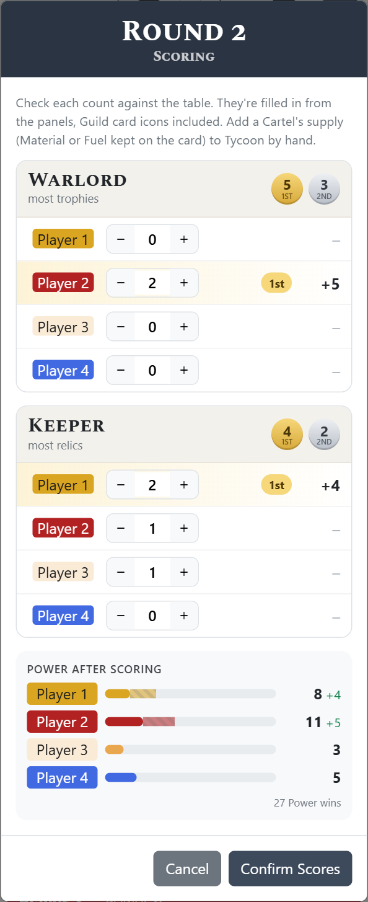

**Scoring** shows each declared ambition as a card with the Power for 1st and 2nd place, and every player's count, filled in from their panels, with their place and the Power they'd gain. Underneath, everyone's Power after scoring is shown against the Power that wins. Check the counts against the table, using **−** and **+** to correct them, and tap **Confirm Scores**. Trophies and Captives go back to their owners after Warlord and Tyrant are scored.

The game ends when someone reaches the Power target, or at the end of round 5, and the app shows who won.

 

## Undo, Save and Load
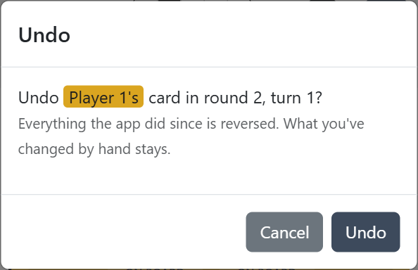

- **Undo:** in the footer. It takes back the last card played and everything the app did for it, but keeps anything you changed by hand since.
- **Save:** in **Options**. It downloads the game as a file.
- **Load:** also in **Options**. It opens a saved game, for example to carry on on another device.

 

---

Found a problem or have an idea? [Open an issue](https://github.com/OZ10/ARCS_Solo/issues).
