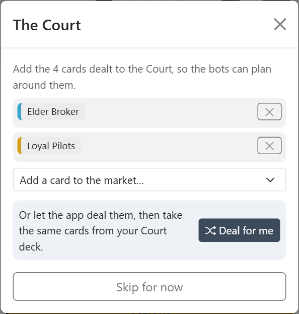
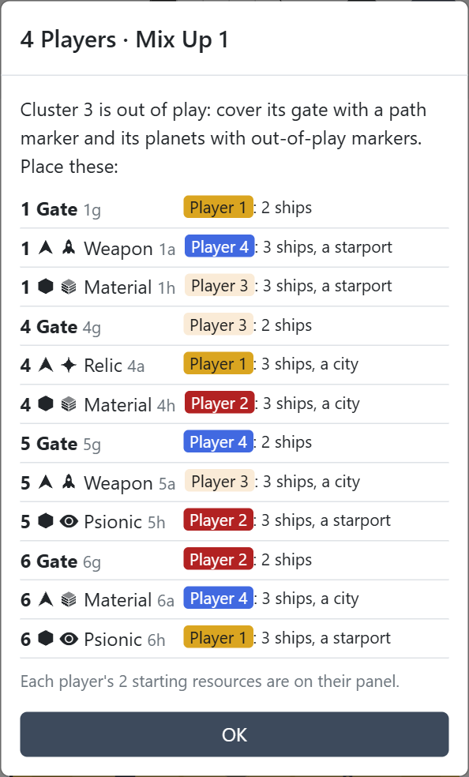
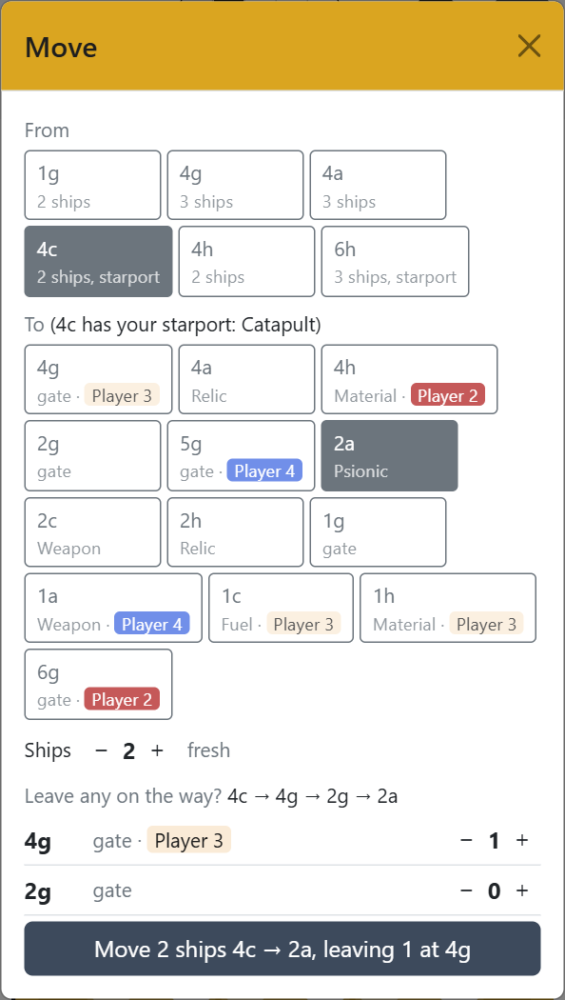
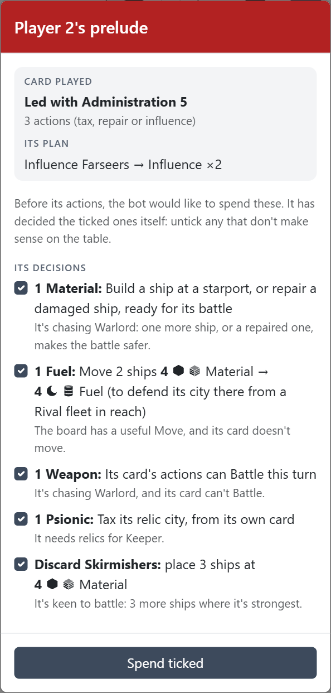
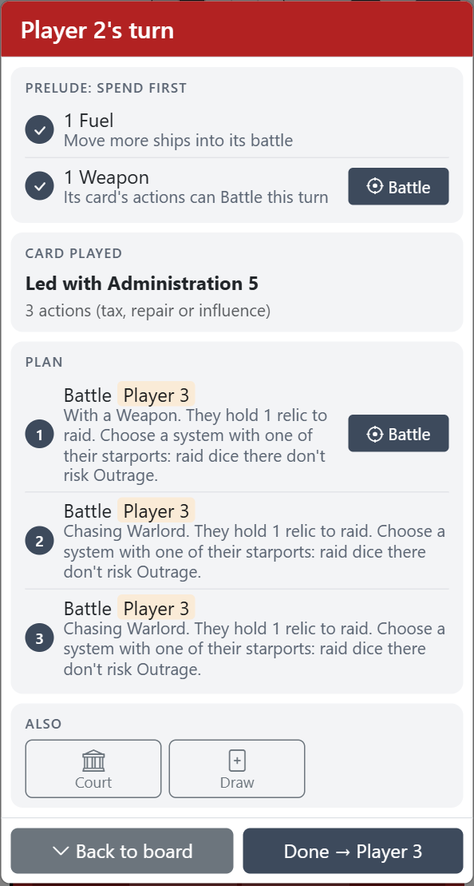
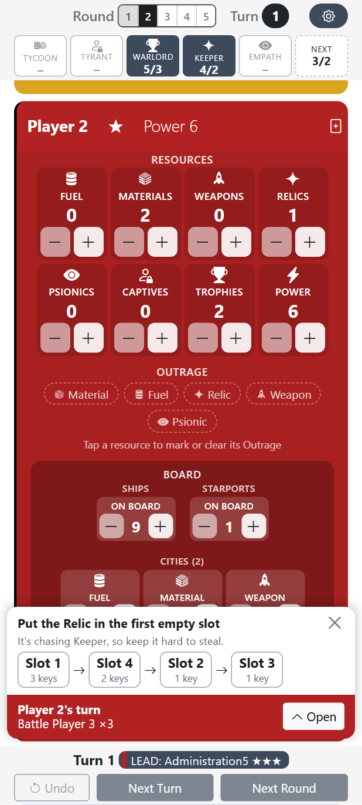
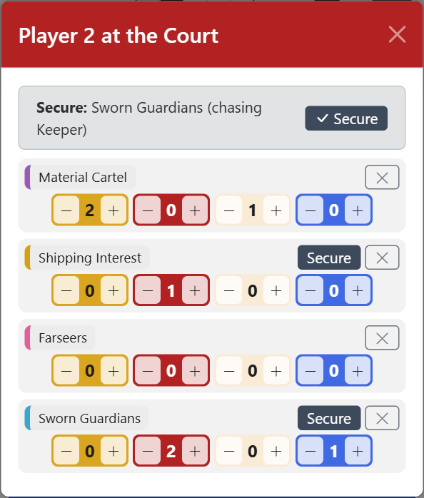
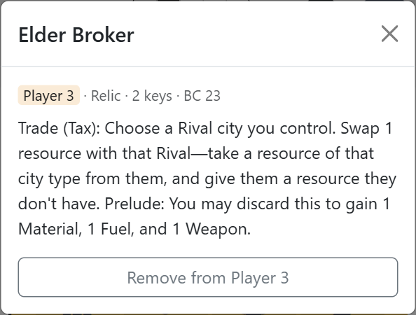
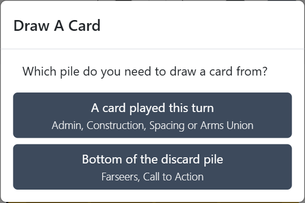

  

<h1 align="center">B4RCS: Bots for Arcs</h1>

<b><a href="https://oz10.github.io/ARCS_Solo/">Open B4RCS</a></b>

B4RCS is a free web app that plays bots for the board game **Arcs**, so you can play solo or fill empty seats at the table. You play the real game on the table. The app decides what each bot does, from the card it plays to the dice it rolls, and keeps a copy of the board so every bot can plan exact moves, such as *"Move 5 ships 2 ⬢ → 3 ▲"*, for you to carry out.

It's made for a phone in portrait, works on a tablet or laptop too, and can be installed so it opens like an app and works offline.

> **What you need:** your own copy of Arcs, and of any expansion you play with. B4RCS covers the base game, the Leaders & Lore mini expansion and, still being tested, the Blighted Reach campaign. It isn't an official Leder Games product.

## Contents
- [Getting started](#getting-started)
- [Setting up a game](#setting-up-a-game)
- [How a game flows](#how-a-game-flows)
- [The base game in detail](#the-base-game-in-detail)
- [Leaders & Lore](#leaders--lore)
- [The Blighted Reach campaign](#the-blighted-reach-campaign)

Sections marked ▸ are folded away: tap one to open it.

## Getting started
Open **https://oz10.github.io/ARCS_Solo/** in your device's browser. Your game is saved as you play, so you can close the app and carry on later.

<b>Installing the app</b>

Use the browser's menu: in Chrome on Android, tap **⋮** then **Install app**. On an iPhone or iPad, tap **Share** then **Add to Home Screen**. Once installed, it opens in its own window and works without a connection.

## Setting up a game
Tap **Options**, then **New Game**, and follow the steps:

1. **Human players:** how many of you are at the table. The other seats are bots.
2. **Colours:** each human player chooses one.
3. **Leaders & Lore** or **Blighted Reach:** turn either on to play with it.
4. **Players:** 2, 3 or 4 in all, and **Start game**. The app deals everyone's hands and picks who starts.
5. **The Court:** enter the cards dealt to the Court, or let the app deal them.
6. **The board:** deal or choose a setup card. The app lists where everyone's pieces go. Set up the table to match.
7. **The mulligan:** with 2 players, the player without the initiative may swap their hand.

Then Round 1 begins.

<b>Setting up in detail</b>

1. **Human players:** how many human players are at the table, from 1 to 4. Human players take the first seats (Players 1, 2…), and the rest are bots. With more than one, you pass the device at each human player's turn. Their hand is covered by frosted glass until they tap **Show my hand**, and covered again when play moves on, so nobody sees anyone else's cards. With 4 human players there are no bots, so Bot difficulty is hidden.
2. **Colours:** each human player chooses a colour. A colour another human player has taken is faded out. The bots take the colours that are left.
3. **Leaders & Lore:** turn on **Play with Leaders & Lore** to play with the mini expansion (see [Leaders & Lore](#leaders--lore)).
4. **How many players:** 2, 3 or 4, counting human players and bots, and at least as many as there are human players. Below it, turn on **Blighted Reach campaign** to play the campaign instead (see [The Blighted Reach campaign](#the-blighted-reach-campaign)).
5. **Start game:** the app deals everyone's hands. A random player starts with the initiative, as the rulebook says, and the ★ shows who. If a game is being played, it asks first, as Undo can't bring it back. To keep it, save it first.

 

6. **The Court:** add the cards dealt to the Court market (4, or 3 with 2 players), or tap **Deal for me** and take the same cards from your Court deck. Bots use this to choose what to secure and influence. You can skip it, but their advice will be more general.

 

7. **Set up the board:** tap **Deal a setup card** for the app to choose one, or pick the setup card you drew from the list. The app places everyone's starting pieces on its board and fills in their panels, including the 2 starting resources. It then lists where each player's pieces go, by system (such as *3 ⬢: 1 city, 3 ships*), and which clusters are out of play. Set up the table to match and tap **OK**. With Leaders & Lore, the pieces come from each Leader.

 

8. **The mulligan (2 players):** the player without the initiative may discard their hand and draw 6 new cards. If that's a human player, the app shows their hand and asks (with more than one human player, under the frosted glass until they tap). Then Round 1 begins. In later rounds it asks once the new hands are dealt, before the round begins.

 

<b>Bot difficulty</b>

In **Options**, under New Game, choose how well the bots play, from **1 (Easy)** to **5 (Hard)**. It applies to every bot from its next decision, so you can change it during a game.

- **1 Easy:** makes plenty of mistakes and takes big gambles. It leaves every prelude spend to you, and spends at most 1 of each resource in a prelude.
- **2 Relaxed:** makes the odd mistake, and plays a little loosely. At most 1 of each resource in a prelude.
- **3 Normal:** plays well, with some surprises. At most 2 of each resource in a prelude.
- **4 Tough:** rarely strays from its best move, and declares an ambition or seizes the initiative when it works out it would win. At most 2 of each resource in a prelude.
- **5 Hard:** always takes the best move it can work out, and does nothing on a whim. Its prelude spends are still ticked for you to check. At most 3 of each resource in a prelude.

Every difficulty plans from the app's board, so keep it matching the table. To see how the bots think, open [How the bots decide](#the-base-game-in-detail) below.

## How a game flows
A game of Arcs is played over up to five chapters, each a round of turns. B4RCS follows the same flow, and tells you whose turn it is.

**A turn:** the player with the initiative leads a card, and everyone else follows it in turn order, as the rulebook says. On your turn you play a card from your panel. On a bot's turn you tap its **Play Card** button and it chooses.

**Your turn:** your turn window counts your actions and has a button for each one, such as **Move**, **Build** or **Battle**. Do the action on the table, then in the app, so its board stays matching.

**A bot's turn:** the bot may spend resources first (its prelude), then shows its plan: numbered steps, each with its reason and the place on the board, such as *"Battle Player 3 at 3 ▲"*. Carry each step out on the table, tap **Completed**, and the app updates its board. Windows help with battles, building and the Court.

**Ending a turn and a round:** tap **Next turn** when everyone has played, and **Next round** when hands are empty. At the end of a round, the app scores the declared ambitions and asks you to check its board against the table.

**Winning:** the game ends when someone reaches the Power target, or after the fifth chapter.

The sections below explain each part in detail.

## The base game in detail

<b>The screen</b>

- **Top bar:** the round and turn, the ambitions declared this round with their marker values, and **Options** (the gear). Tap an ambition to see how it's won and what it's worth, and to declare it for any player, bots included: for example after a Surpass with Galactic Bards, or with Populist Demands.
- **Announcements:** at the start of each round and turn, a card says who leads. It closes by itself, or when tapped.
- **What happened:** everything else the app tells you, such as a battle's results or an ambition declared, is listed above the turn bar and at the top of the turn window, newest first. Each stays until you close it with **×** or tap **Clear all**. The newest 3 show; tap **+N earlier** for the rest.
- **Player panels:** one per player in their colour. Tap a player's name to open or close their panel. The banner shows how many cards they hold, so you can see how many turns everyone has left, and the ★ shows who has the initiative.
- **Panel sections:** each panel's **Resources** (with Outrage), **Board** and **Guild cards** sit under a header you tap to open or close. A closed header shows small counts, such as the resources held and the ships on the board. The hand and **Play Card** always show. In **Options**, **Panel sections** chooses how they start:
  - **All open:** always open.
  - **Turn** (the default): closed until the player has played their card, then open until the next player's turn.
  - **All closed:** open one by tapping its header.

  A closed section opens when the app changes it, such as after a battle or scoring.
- **Tiles:** each panel has **−** and **+** tiles for resources, Captives, Trophies, Power, ships and starports on the board, and cities on each planet type. Resources and cities show only an icon, after the game's tokens, and the ambitions in the top bar use the same ones. Bots use them to make their choices, and they're filled in for you when the app knows what happened. Ships, starports and cities follow the app's board, so correct those with **Check the board** in **Options**: a change on the tile alone is replaced the next time the board changes.
- **Outrage:** under the tiles, the resources that player is Outraged in are marked red. It's filled in when a city is destroyed or Outrage Spreads is played, and you can tap one to mark or clear it. A bot won't spend an Outraged resource in its prelude.
- **Guild row:** the Guild cards each player holds. Tap **+** to add one, or tap a card to read it or remove it.
- **Footer:** **Undo**, **Next turn** and **Next round**, with the cards played this turn listed above them.
- **System names:** systems are named as on the board: **1 Gate**, and planets by their cluster number and ID symbol (▲, ☾ or ⬢), then their type, such as **3 ⬢** Weapon.

<b>Your turn</b>

Your hand is listed on your panel. Tap a card to see its pips, ambition and actions, then choose how to play it:

- **Leading:** **LEAD**, or **DECLARE** to declare the ambition on it.
- **Following:** **SURPASS**, **COPY** or **PIVOT**.
- **CLAIM:** turn this on to also seize the initiative with a card played face down.

 

**Your turn window** then opens, like a bot's. It counts your actions, such as **3 of 3 actions left**, and lists each kind your card gives you with a button and what's possible on the board, such as *"Where your ships meet a Rival: 2 Gate (Player 3)"*. Take the same action as many times as your card allows. Each one you do on the table, do in the app too:
- **Move:** choose where from and where to (only the systems your ships can reach, Catapult included, one line per cluster: Gate, Arrow, Crescent, Hexagon, each with a bar in its resource's colour) and how many fresh and damaged ships. The count starts at 0 with a reminder, so you never move them all by mistake. If the ships pass through other systems, the window shows the route, with **−** and **+** for any you left on the way, and **Choose the route** if you went another way. The button says what goes on the board, such as *"Move 5 ships 3 ☾ → 5 ▲, leaving 2 at 3 Gate"*. A bot's Moves say how many fresh and damaged ships go: its damaged ships go with the fleet when all its fresh ships leave, and into a battle.
- **Build, Repair and Tax:** only what the board allows: a city or starport on a planet with an empty slot where you have a piece (damaged if a Rival controls it), a ship at each starport once a turn, your damaged pieces, and your cities or a Rival's city in a system you control (which also captures one of their agents). Tax adds the resource to your panel, unless none is left in the supply.
- **Battle:** opens the Battle window, starting on a Rival you share a system with, and the counts from the board. **Where** lists the systems you could battle in. When it updates the panels, it counts as an action.
- **Secure and Influence:** **Court** opens the Court window. Each agent you place there and each card you secure counts as an action.

Once you've taken an action, the prelude is over, so its buttons go. An action your prelude gave you, such as a Move from a Fuel, comes first: it's listed at the top, and your card's actions wait until it's done.

Each action you've taken is listed under **Done**, with **Undo**, which takes it off the board and gives the action back. When none are left, the buttons are greyed out. **Prelude** lists what your resources and Guild cards can do before your actions. **Spend** takes the resource off your panel and adds its action, such as a Move for a Fuel, marked **PRELUDE**. **Use** does the same for a Guild card. Anything your card doesn't have is under **Also**, with **Draw**. Tap **Done** when you've finished. **Back to board** shrinks the window to a bar, as on a bot's turn.

 

<b>A bot's turn</b>

Tap the bot's **Play Card** button. The bot works everything out from the app's board: how big a fleet it can bring to a battle, where it can build, which cities it can tax and which Rivals it can reach.

**Its prelude:** before its actions, a bot may offer to spend resources or use Guild cards. The window shows the card it played and its plan without them. Where the app knows enough, the bot decides for itself: those are already ticked under **Its decisions**, each with its reason. Untick any that don't make sense on the table. The rest are under **Your call**: tick the ones that make sense on the board. The app updates its resources for you.

A bot can spend several resources in one prelude, one for each useful action, and never one it needs for an ambition it has declared or could declare. When it's first in an ambition, it also keeps a resource if spending it would let a Rival catch up by taxing a city of that resource, as a spent resource goes back to the shared pool. Only a very useful spend goes ahead anyway: a Move to its battle or to defend a city, building a city, a Secure that captures Rival agents, or a Battle at good odds. What it keeps, and why, is listed under **Kept**.
- **Material:** a Build for each good spot on the board (past the first, only a city, or a ship for its battle), or a Repair of a damaged building, or of a damaged ship before a battle.
- **Fuel:** a Move for each useful one its card can't cover. With a Copy or Pivot, its one action stays free for something else.
- **Relic:** a Secure for each Court card worth securing, more so with Rival agents on it.
- **Weapon:** when the board shows a battle at good odds that it can reach.
- **Psionic:** any action from the lead card it knows is worth it, its own card too when it led: a card to Secure or Influence, a city to Tax, a Move or a city to Build, or one more Battle at good odds. Several Psionics give several actions.

 

**The turn window** then shows the whole turn:

- **Prelude:** what it spent first.
- **Card played:** what it played, and the actions it gives.
- **Plan:** numbered steps with the reason for each, naming the systems: *"Move 5 ships 2 ⬢ → 3 ▲ (to set up the Battle)"*, *"Battle Player 3 at 3 ▲"*, *"Build a city at 4 ▲ (Relic)"*, *"Tax its relic city at 2 ⬢"*, *"Repair a damaged ship at 1 Gate"*. Steps that need a window have a button beside them, such as **Battle**, **Build** or **Court**.
- **Also:** anything else it may use this turn.

Carry out each step on the table and tap its **Completed** button: the app puts it on its board, so the next step's window counts from it. **Done** moves on to the next player, and makes any steps you didn't tick on the board too. A planned Move is checked against the board each time the window is shown: if a Catapult can't get past a gate someone else controls, the Move stops in that gate and says why.

 

**Back to board** shrinks the window to a bar above the footer, so you can tap the tiles while still seeing the plan. Tap **Open** to bring the window back. It also comes back by itself when you finish a battle, build or Court action.

When a bot gains a resource, a box above the bar says **which resource slot to put it in**, high keys first if it wants to keep it safe from raids. It stays until you close it or the turn ends. A bot with no room for a resource it steals or is given returns the one it needs least, and says so.

 

<b>What you handle for the bots</b>

The app plays each bot's cards and makes its choices, but it can't see or touch the table. You're its eyes and hands:

- **Its pieces:** move its ships, and place or remove its buildings, agents and resources on the table, where the plan says.
- **Its panel:** the ships, starports and cities on its panel come from the app's board, and the app fills in its resources when it knows what happened, such as after a prelude, a tax, a battle, a build, the Court or scoring.
- **The board check:** at the end of each round, the **Check the board** window goes through each cluster in play, listing every player's ships and buildings in each system. Correct anything that doesn't match the table with **−** and **+**, **+ Ships**, **+ City**, **+ Starport** and **×**, then tap the next cluster and **Done**, or **It all matches: done**. This catches anything that didn't go through the app, such as a step you skipped. You can open it any time from **Options**, **Check the board**.
- **Its dice:** roll the dice it chooses, then enter what's left.
- **The Court:** when a card leaves the market, add its replacement.

**The plan is advice.** A bot plans its turn from the app's board, which can drift from the table between board checks. If a step doesn't make sense on the table, such as a battle it can't reach or a card that's no longer worth securing, skip it or use that action for something better. Play the bot the way a sensible player would. The plan is set when the turn window opens, so you can follow it step by step.

<b>Battles</b>

Tap **Battle** in the turn window, yours or a bot's.

For a bot:
1. **Defender:** it starts on the Rival it wants to fight, and says why.
2. **Counts:** filled in from the app's board for the system in the plan: the attacker's fresh and damaged ships, the defender's ships and buildings, and the planet type. Correct them if the table is different. After the roll, set the attacker's damaged ships too, so the board knows.
3. **Raid:** if the bot can raid, choose what it's after and enter the keys shown on that slot of the defender's board. Raid dice need a building in the system, or a defender with no buildings on the board at all.
4. **Choose dice:** tells you which dice to roll and how to assign the hits, including which building to hit first and why. The attacker chooses where its hits go. It weighs up the risk to its ships, what destroying a city would cost in Outrage, any Ransack, and what the defender loses, such as their last starport. When its plan has another Battle after this one, it damages fresh ships first, so its next attack faces fewer of them. **Details** shows the odds.
5. **After rolling:** set the counts to what's left. Attack again, or tap **Done battling**.

 

**Done battling** shows the results: ships destroyed and taken as Trophies, which buildings were destroyed, Outrage and Ransack, and anything stolen. The app knows from the board which buildings were destroyed and what planet they were on. It only asks when the defender had a city and a starport there and not both were destroyed. Check them and tap **Save the results** to update both players' panels and the board.

For your own battles, the window doesn't choose dice. It keeps count while you roll, then updates the panels in the same way. For what you stole, use **−** and **+** for each resource, as you can take more than one of a kind, and tick any Guild card. In a gate, **Gatekeepers'** 2 extra dice are added without asking.

 

<b>Building</b>

Tap **Build** in a bot's turn window. The app has already chosen from its board what to build and where, and says why: a city, a starport or a ship. Bots like 2 starports, and 3 from round 3, so they can build more ships each turn. Tap **Built it** to put it on the board and update its panel, or **Something else** if it can't be built on the table.

 

<b>The Court</b>

Tap **Court** in the turn window, yours or a bot's. It lists the cards in the market with everyone's agents on each in their colours. Use **−** and **+** to keep the agents up to date, **×** to remove a card, and the list at the bottom to add its replacement.

For a bot, the top line says what it would secure or influence, with a **Secure** or **Add agent** button that does it for you. **Secure** takes a card the player can secure, captures any Rival agents on it, and moves it to their Guild row.

If a card leaves the market, the turn window reminds you to add the replacement.

 

<b>Guild and Vox cards</b>

Tap a card in a player's Guild row to read it or remove it. Tap **+** to add one, which removes it from the market. For a bot, the list includes the Vox cards so you can record what it secured.

**Vox cards** are carried out by the app. A bot chooses for itself: Mass Uprising's cluster from the board (near a threatened city, its buildings or a battle), with the ships placed on the board; Song of Freedom returns a Rival city it controls, or now and then its least needed city, and seizes the initiative. When you secure or Ransack a Vox card, a window lets you choose: the cluster, the ambition to declare, the city to return, the Guild card to steal, or drawing the bottom card of the discard pile.

Bots use their Guild cards themselves: they offer them in their prelude or instead of actions, and they're included in battles, scoring and the cards they choose. A Loyal Guild card makes a Rival's city of that type a better target, as the Outrage from destroying it costs the bot little. Your **Farseers** card has a **Use its prelude** button, and when you declare with it, you choose one Rival's hand to look at and swap with.

 

<b>Drawing, declaring and seizing</b>

The icons on your panel's header are:

- **Draw:** add a card to a hand, either one played this turn (the Unions) or the bottom card of the discard pile (Farseers, Call to Action). Bots have this icon too.
- **Seize:** seize the initiative, for example with a Vox card.

To declare outside your turn's card, tap the ambition in the top bar. Bots seize and declare by themselves.

 

<b>Ending a turn and a round</b>

When everyone has played, tap **Next turn**. When nobody has cards left, tap **Next round**. Before the next round starts, the app asks you to check its board against the table (see **What you handle for the bots**).

**Scoring** shows each declared ambition as a card with the Power for 1st and 2nd place, and every player's count, filled in from their panels, with their place and the Power they'd gain. Underneath, everyone's Power after scoring is shown against the Power that wins. Check the counts against the table, using **−** and **+** to correct them, and tap **Confirm scores**. Trophies and Captives go back to their owners after Warlord and Tyrant are scored.

The game ends when someone reaches the Power target, or at the end of round 5, and the app shows who won.

 

<b>Undo, Save and Load</b>

- **Undo:** in the footer. It takes back the last card played and everything the app did for it, but keeps anything you changed by hand since.
- **Save:** in **Options**. It downloads the game as a file.
- **Load:** also in **Options**. It opens a saved game, for example to carry on on another device.

 

<b>How the bots decide</b>

**Ambitions:** bots weigh each ambition by where they place now against their Rivals, and where their remaining cards are likely to take them this round: a Tax card with a city of that type, or a Battle card with a fight at good odds. They lead the ambition they're most likely to place in, and declare one when they're likely to come first. They often declare when one more would put them first, and sometimes when they're likely to come second while whoever is likely to come first isn't leading on Power. Late in a round, with few cards left, they stop chasing what they can't reach.

**The leader:** bots watch the player with the most Power, you included. They won't declare an ambition the leader is likely to place in unless they're likely to win it themselves, and not even then if the leader's place would take them to the Power target. They'd rather battle, raid, capture agents from, block and tax the leader, steal from them, and surpass to take the initiative from them, more so the further ahead the leader is and the nearer the target.

**Following:** a bot surpasses for more actions than a Copy or Pivot gives, or to take the initiative for an ambition it holds a card to declare. It seizes the initiative when it wants to declare one and has too few high cards to surpass later, and it keeps the card it means to declare with.

**Its plan:**
- **Building:** a city when its resource slots are nearly full, and ships when Rivals have clearly more.
- **Moving:** always with a purpose: a battle, a city to defend, a Rival's city it has the ships to control, or a planet to build on. It holds a gate a Rival fleet would Catapult through to reach its buildings (and its own cluster's gate when it has two or more buildings there), and keeps those ships there while the gate still protects something. It spreads out to open planets, and a few ships waiting there to build stay until something changes.
- **Guards:** it keeps ships on its cities, enough to hold one a Rival fleet could reach, and won't take guards from a city it values more (one whose type counts for an ambition it's chasing) to defend one it values less.
- **Battles:** it battles Rivals whose buildings in reach have no guard, only at good odds, and attacks more than once when another attack can clear most of a Rival's pieces.
- **Taxing:** for what its hand lacks, such as Fuel with few Move cards.
- **Repairs:** only as many as it has damaged pieces.

**The Court:** it values Guild cards that draw a card, steal or give a new action. It places agents only on cards it can win with the agents and turns it has left, not where a Rival has many agents that would make its own easy Captives, and it places one to stop a Rival securing a card worth a lot to them.

Every level below Hard sometimes misses what this says, or acts on a whim, Easy most often. Hard always follows it.

## Leaders & Lore
Turn on **Play with Leaders & Lore** in New Game to play with the mini expansion. Everyone drafts a Leader and a Lore card, the app sets each player up from their Leader, and the bots use both, on the board too.

<b>The draft and setting up</b>

**The draft:** after the Court, everyone drafts as the rulebook says. There's a row of Leaders and a row of Lore cards, one more of each than there are players, and players pick in reverse turn order. You take one card type in the first round and the other card type in the second. Tap a card to read it, then **Take** it. The bots pick at random.

**Setting up:** the app sets each player up from their Leader: their starting resources, and what to place in systems A, B and C. An Archivist also chooses 2 extra Lore cards. Each player's Leader and Lore are shown above their Guild row. Tap one to read it.

 

<b>What the app does for you</b>

- **Scoring:** the Elder, Warrior, Archivist and Noble score as their cards say, and the scoring window says why. The Fuel-Drinker discards its Fuel when Tycoon is scored.
- **Declaring:** when someone declares an ambition, the app carries out Ambitious (Upstart), Generous (Feastbringer), Bold (Demagogue) and Connected (Noble). When it's you, a window asks what you'd like to do. Bots do it themselves, and their turn window says what they did.
- **Securing:** a Demagogue can't secure a Guild card with only 1 of its agents on it.
- **Battles:** extra dice and dice limits (Rebel, Corsair, Raider Exosuits), raid limits (Hidden Harbors, Keeper's Trust, Keeper's Solidarity), intercepts (Agitator, Mirror Plating, Railgun Arrays) and no Ransack against the Elder. After a battle, Quartermaster's and Repair Drones' repairs go on the board.
- **Ancient Holdings:** its extra resource slot is included when the app says which slot to put a resource in.
- **Taxing:** Mystic, Fuel-Drinker and Agitator gain their extra resource when they Copy or Pivot to Tax.

<b>On the board</b>

- **Moving:** Shaper Catapults from gates, not starports. Rebel moves no more than 2 ships at a time, in the Move window too. Sprinter Drives lets fresh ships take one more step. Warrior's Tactical gives a Copy or Pivot to Battle a free Move to reach it.
- **Building:** Overseer has 2 ships fewer to build. Hidden Harbors builds ships fresh. Cloud Cities adds a city outside the slots where none is left, for 1 resource of the planet's type (in the Build window too).
- **Gates:** with **Gate Ports** or **Gate Stations**, the Build window offers a starport or city on a gate, 1 per gate. A gate city counts as every type of city in its cluster (the planets there with anyone's city on): it can be taxed for any one of them once a turn, the Tax window lists each type, and destroying it Provokes Outrage of each. Bots with Gate Stations build gate cities, preferring one that gives them types they have no city of yet, and move a ship to such a gate to build one there. Gate Ports captures an agent when a Rival's ships move into a gate its holder controls with a fresh starport.
- **Taxing:** Anarchist taxes Rival cities and empty slots where its ships are, never its own. Upstart taxes its own cities only where it controls them. Empath's Bond (while Empath is declared) taxes any city without a Captive, and builds ships and Catapults at any starport. Shaper's Mythic changes a planet's type for the rest of the game: a bot does it for the type it's chasing, and you get a window after a Tax.
- **Defending:** a bot defending with Predictive Sensors moves its fresh ships in from next door (leaving 1 on its buildings) as the Battle window opens, already on the board.

Without Leaders & Lore none of this applies.

<b>How the bots use them</b>

A bot's plan has a short line under any step its Leader or Lore changes, such as *Rebel, Disorganized: no more than 2 ships at a time*. Bots lean towards the action their Leader improves when they Copy or Pivot, and Noble's Influential and Feastbringer's Charismatic add their free Influence to the plan.

**Lore actions** in place of a normal action are the bot's own decisions from the board, ticked with a reason in the **Guild and Lore actions** window: Summon (a ship at the city it controls nearest a fight or a threat), Fire Rifles (skirmish dice at Rival ships next door; tap **Completed** and enter the hits, and the board damages or destroys their ships, damaged ones first), Nurture and Prune, Guide (Rival ships off its starport, or its own onto its battle), Martyr and Annex. Each has a **Completed** button in the turn window that puts it on the board.

**Your own Guild cards:** your turn window also has a **Guild cards** section for Guild cards whose action replaces one of your card's: Manufacture, Synthesize, Pressgang, Execute, Abduct and Trade (and, in a campaign, Spy, Recover and Bargain). Each opens a window and uses up the action it replaces. Pressgang and Execute ask whose Captives they are, so the app knows where those agents go. Bargain gives the card to the Rival and adds your Influences and Secure to Your actions.

**Your own Lore cards:** your turn window has a **Lore cards** section for the Lore that replace an action (Summon, Fire Rifles, Nurture, Prune, Guide, Martyr and Annex). Each one opens a window to choose where, then puts it on the app's board and uses up the action it replaces. Lore with a prelude (Warlord's Terror, Tyrant's Ego, Tycoon's Ambition and Charm, and the cards you can discard to clear Outrage) are offered in your prelude, with **Undo**.

**In its prelude**, a bot uses Lore such as discarding a card to clear an Outrage, and Warlord's Terror and Tyrant's Ego name the Court cards it influences or secures.

## The Blighted Reach campaign
Turn on **Blighted Reach campaign** in New Game to play the campaign: three Acts of up to three chapters each, with the bots playing every Fate. It's new, so expect rough edges, and please [report](https://github.com/OZ10/ARCS_Solo/issues) anything that doesn't match the rules.

<b>Fates and setting up</b>

**Choosing Fates:** with the campaign switched on, choose how Fates are given out. **Deal 2** deals two and you (or the bot) choose one. **Pick** lets you choose any "A" Fate, to try a particular one. At the start of Acts II and III, each player keeps their Fate or takes a new one.

**Setting up:** the setup window lists each step to do on the table, with the dice already rolled: the Imperial clusters, Free cities, Blight, the Imperial Council and the starting Policy in Act I; each player's Fate setup and the new Blight in Acts II and III. Tick each step as you go. In Act I, the app puts the Reach on its board: Imperial ships, Free cities and Blight. Then each player places 3 ships and a building at a planet with an Imperial ship, in turn order and back again. The bots choose for themselves, and a window lists where you can place yours. The app then fills the empty slots on Imperial planets with Free cities and lists what to place on the table.

**The panels:** each player's panel shows their Fate (tap it to read the card), their title (**Regent** or **Outlaw**, tap to change it), the First Regent, their objective marker and Favors. The Imperial Trust has its own panel.

<b>The board in the campaign</b>

**Flagships:** when a Fate gains a Flagship, the app turns that player's cities and starports on the map into Free ones and places the Flagship: a bot where it has the most pieces, and you in a window. The player's panel then shows a Flagship section instead of the map's city and starport tiles: where it is, and its 6 Upgrade slots with Armor above. Tap a slot to build there, or to mark it damaged, repaired or destroyed. The section counts its fresh starports (its dice in battle) and cities (each opens a resource slot). In the Move window, **Flagship moves too** moves it with your ships or alone; bots take theirs with their fleet. In a Blight Crisis it takes hits once its player has no other ships there, rightmost Armor first, and the Intermission destroys damaged Upgrades and Armor. In a battle, the Battle window notes what a Flagship adds; change its slots on the panel afterwards.

**The board in the campaign:** the app's board also holds Imperial ships, Blight, Free cities and starports, Flagships (their Upgrades and Armor aren't tracked yet: they stay on the Flagship board) and the Fates' tokens, such as Golems, Banners, Seats and Ceasefires. **Check the board** has **+ Imperial**, **+ Blight**, **+ Flagship** and **+ Token** to correct them.

**The board between Acts:** at the Intermission, the app repairs the Blight and destroys the damaged pieces, and the buildings in systems with Blight and no ships, on its board and lists them. At the start of Acts II and III, it adds the new Blight and says where. A player left with no ships or starports chooses a gate for their 3 new ships in the Intermission window. The Fates' setups put their tokens on the board too: the Caretaker's Golems, the Pacifist's Witnesses, the Peacekeeper's Ceasefires and the Pathfinder's Pilgrims, rolled by the app.

<b>During a chapter</b>

Event cards are shuffled into the action deck. When one is played, the app rolls the event die and walks through the end of round: the Imperial Council, Summits, then Crises or Edicts, with the First Regent's Policy. Fate cards are added to the Court and Guild rows like any other card. In a Crisis, the app deals the Blight's hits on its board and lists what changes in each system, for you to match on the table. When a bot First Regent requisitions ships, it places them on the board itself. When you're First Regent, a window lists where they can go, and you tap where you put them.

In the Court, while someone holds Guild Investigators, a Court card with no agents has a list to **attach** a Guild card from the discard pile (Recover). The attached card shows under it, goes with it when it's secured, and makes it worth more to the bots. The Imperial Council's row has an **In Session / Decided** switch, for when it changes on the table without the app.

<b>How the bots play</b>

A Regent bot follows the Empire's laws (moving and battling alongside Imperial ships, and leaving Rival Regents alone where there are Imperial ships) and would rather battle an Outlaw. Bots value the Imperial Council. As First Regent a bot weighs each Policy from its side (what the Demand adds to its Imperial Trust for the ambitions it's chasing, what it pays itself, draining its Rivals and the leader, and what the Imperial Action gives it against them) and changes the Policy when another serves it clearly better for the rest of the Act; the Edicts window lists all three with their worth. It also chooses whether to make a Rival Regent with no agents left an Outlaw. When a bot may call a Summit, it weighs leaving the Empire (its Fate, stealing from the Imperial Trust, what the Edicts take) against staying (being First Regent, the Imperial ships), and says why. It also revives the Empire when there are no Regents, and petitions the Council when it wants it again.

Early in each Act (chapters 1 and 2, as each Act adds new Blight) bots spread out, clear the Blight (damaged Blight needs fewer ships) and build, and at any time they clear Blight on their own buildings. A bot battles a Rival only for a reason: chasing Warlord or Tyrant, raiding what it's chasing, slowing the leader, an unguarded building, a city it can destroy cheaply, or its Fate; Imperial ships count in the odds, defending a Regent against an Outlaw and joining a Regent's attack. Bots battle the Free States, the Blight and, as Outlaws, the Empire: when one is worth it and the board shows it in reach, the plan says where, and the Battle window starts with it chosen and the counts from the board. The board follows the Empire's laws: the Empire controls any system with a fresh Imperial ship, and a Regent with pieces there controls it on their turn (Presence Law); a Catapult stops at any Blight, and at the Empire's gates for an Outlaw; and a Regent can't battle or tax a Rival Regent where there are Imperial ships (Truce Law). Each bot plays towards its Act I objective and uses its Fate cards, and its turn window has a section explaining what its Fate wants this turn. Under **Playing towards it** it lists what its Fate changes. Most Act I objectives pay for winning ambitions under a condition (as First Regent, as an Outlaw, with Golems, without Outrage): while it holds, the bot declares more readily and leads with the ambitions it would win. Fates with goals on the board plan for them: the Founder moves to take systems, the Caretaker goes after Golems (the board shows when it controls one, and then it Awakens them), and the Admiral battles alongside Imperial ships.

**Act II Fates:** each bot plays towards its Act II objective too. Its turn window lists what that changes under **Playing towards it**: which resources it keeps or spends, the battles it won't fight, where it moves, the Court cards and Policy it wants, and the ambitions it leads with. Steps its Fate shaped are tagged with the Fate's name. Fate tokens the app can't see, such as Banners, Clues, Hammer Fragments and Seats, are listed under **On the table**. A bot Believer asks once a chapter whether each declared ambition has an Ideal marker.

**Act III Fates:** bots play towards their grand ambitions, or a "C" Fate's final objective, in the same way. Some never declare an ambition their Fate needs no Rival to win, and chase it once a Rival declares it; the Judge stops adding to an ambition once it's tied for first.
- **Edenguard and Blightkin:** while the Guardian or the Naturalist is in play, the new ambition has its own chip in the top bar and a button in the Declare window, under the ambition it replaces. The app counts them from its board (Fuel and Material planets, or systems with fresh Blight, each player controls), and you can correct them in the scoring window. A bot Guardian or Naturalist leading with a Tycoon or Empath card declares the new ambition when the board shows it controls the most.
- **The Pathfinder:** a bot asks each turn whether it controls the Portal (or reads it from the board once the Portal token is on it), and moves its Flagship there if not.
- **Grand ambitions from the board:** the Admiral's, the Pathfinder's and the Peacekeeper's are checked from the board at the end of each chapter, rather than asked.
- **Fate card actions:** in Acts II and III a bot decides its Fate cards' own actions from the board, with a place and a reason, in its prelude and Guild actions window: Claim Fief (a Seat), Building Bunkers, Repair Hammer (a Hammer Fragment), Prepare and Break World, Spawn and Seed (Blight), Incite Revolt, Planting Banners, taking a Witness at a Psionic planet (the Pacifist carries its Witnesses there with its ships), Awaken (the Caretaker's Golems it controls go onto its panel), and moving Pilgrims towards the Portal and through it (Act III). In a cluster at Peace (the Peacekeeper's Ceasefires), a bot only battles with a Weapon to spend, and the app flips the cluster to War after the battle. Its turn window has a **Completed** button for each that puts it on the board. Uncovering Clues too: the player to the Pathfinder's right holds the Portal's planet. When that's a bot, the app chooses it at setup, keeps it secret and places each Clue; when it's you, a window asks which Clue you place. Its Fate's Moves go where the board shows its Fate wants them, such as its Flagship to a planet with no Banner, and the end-of-chapter objectives the board can count (Banners, Seats, Bunkers, Blight, Passages, the Empire's planets and more) are counted rather than asked.
- **Your Fate cards:** in a human player's turn window, a **Fate cards** section lists your Fate's own actions, each with a window that puts it on the app's board: choose where (a Seat, a Bunker, a Hammer Fragment, Prepare, Break World, Spawn, Seed, Incite Revolt, Planting Banners, a Witness, Awaken, Use the Portal), or move each Pilgrim. One in place of an action uses up that action; a prelude one is once a turn. A human Pathfinder uncovers Clues there when a bot holds the secret: pick the resource to spend and the app places the Clue. In a Fate's setup, a window makes up or scraps your ships on the board (or places the Pirate's gate ships).
- **The Warden's Fiefs:** a Seat above its owner's city makes them Lord of that cluster; Rivals with a city or Flagship there are Vassals. The Lord's Tax window (and a bot Lord) can tax any city in the Fief, capturing from Vassals. When a Lord and a Vassal battle there, the Battle window warns, and whoever harms the other Provokes Outrage of every city type in the Fief when the results are applied. The panels show Lords and Vassals, and Lord Over the Fiefs is counted from the board.
- **The Pirate's Rumors (Act III):** with a bot Pirate, the app keeps the Haven secret: any 4 Rumor tokens mark the places, and the Pirate's panel has a **Rumors of the Haven** window to mark agents on them, peek (you) or learn (bots), and flip them. With a human Pirate, you tap the 4 planets you used, and answer True or False when a bot peeks. At the end of Act III each Rival guesses the Haven's planet (bots from what they've learned), and the app gives +10 or -10 Power.
- **Slipstream Drive:** once a turn, in the prelude, a Flagship with a Slipstream Drive Catapults either itself alone or other ships from its system. Yours is a prelude row that opens the Move window from your Flagship, using none of your actions; a bot uses it when a Catapult from its Flagship reaches somewhere useful.
- **Witnesses** move with the Pacifist's ships only from a system it controls, checked before they leave; your Move carries them too.
- **The Gate Wraith:** the app's board has the Twisted Passage in the middle of the map, with the event die: ships move into it from systems next to a gate with a Passage, and out of it to planets with the die's symbol (the die is rerolled as they leave). A gate with a Passage is out of play, and the gates either side of it join up. A Catapult from a planet into its own cluster's gate can collapse it: a bot does when it has another starport, or with a Rival's starport it controls (Catapult Overdrive); in your Move window it's a **Break the gate** switch. The Dead Live's ships (players' and Imperial) come back fresh on the Twisted Passage after scoring, and Control the Twisted Passage is counted from the board. Passage Storms has a **Hit them** button in the Crises window, and **Check the board** has a Twisted Passage page.
- **The Conspirator:** a bot places a Conspiracy instead of a marker. Put any Conspiracy token face down without looking at it: the app keeps who it's for secret, reveals it after scoring and moves the objective. To guess one, tap **Foil a Conspiracy** on its panel.

<b>Objectives and between Acts</b>

**Objectives:** at the end of each chapter, a window lists the objective markers that moved and why, and asks you anything the app can't see, such as how many systems a bot controls. Move the markers on the table to match. In Act III, "A" and "B" Fates are asked which grand ambitions they fulfilled and gain the Power for them, and a "C" Fate that completes its final objective with Power wins the campaign.

**Between Acts:** the Intermission works out everyone's Power for the next Act. Each step between Acts is saved as it's reached: the Intermission, choosing Fates (with the same Fates dealt), the Fates revealed, and the next Act's setup. If the app is reloaded partway through, it carries on from that step, and nothing is done twice. After Act III, the player with the most Power wins, unless someone completed their final objective.

<b>Deals and Summits</b>

**Deals with the bots:** in any Summit, whoever called it, the Negotiations section has a **Deal with Player N** button for each bot.
- **Building the deal:** what you give and what you want from the bot, from the Negotiation actions: Transfer Asset, Promise Favor, Cede Control, Delegate Authority and Invite to Empire.
- **The bot's answer:** it weighs what it gets against what it gives, and accepts, makes a counter-offer, or refuses, with its reasons. It asks more of the player leading on Power, and remembers deals made with it.
- **After a deal:** the app updates the panels and lists what to move on the table.

**The bots' own deals:** when a Summit opens, whoever called it, each bot may offer one deal. A bot with nothing to offer says why. It asks for a resource it's chasing and gives what it can spare. You can accept, make a counter-offer, or say no thanks. Deals between two bots are settled straight away and listed. A bot that calls a Summit also calls in Favors it holds (your agents on its Fate card), the leader's first, to force the most useful action: a resource it's chasing (the app asks the raid cost shown on that slot), a Captive or Trophy, Invite to Empire, Cede Control of a city (on the app's board too) or Delegate Authority on a Court card it wants. In its deals it may hand back one of your Favors as payment, and the deal builder has **Return Favor** when either side holds the other's.

**The Magnate:** bots can be dealt it.
- **Merchant League:** the resources it gains when it declares an ambition are shown on its panel. They can only be given away in Summit deals, and its Crisis empties them.
- **Its objective:** the app moves it for each resource or Favor a Rival gives the Magnate, and for each export of 3 resources. A human Magnate has an **Export to the Galactic Core** button in the Summit. In Act III they play their usual game rather than chasing their grand ambitions. Faithful cards played from a hand, Flagships and Fate tokens are handled on the table.

---

Found a problem or have an idea? [Open an issue](https://github.com/OZ10/ARCS_Solo/issues).

**Credits:** B4RCS was created and originally developed by [OZ10](https://github.com/OZ10), from December 2024. Since 31 October 2026, all the major development has been done by [Claude Code](https://claude.com/claude-code), Anthropic's AI coding assistant, working with OZ10, who designs, play tests and directs the app.
