

  

<h1 align="center">B4RCS: Bots for Arcs</h1>

<b><a href="https://oz10.github.io/ARCS_Solo/">Open B4RCS</a></b>

B4RCS is a free web app that plays bots for the board game **Arcs**, so you can play solo or fill empty seats at the table. You play the real game on the table, and the app decides what each bot does: which card it plays, whether it declares an ambition, what it spends, who it battles and which dice it rolls.

The app can't see the board. When a bot needs to know something only the board shows, it asks you a quick Yes/No question, and you move its pieces for it. The app keeps track of everything else: each bot's hand, resources, cities, Guild cards, the Court and the score.

It's made for a phone in portrait, works in landscape too, and can be installed so it opens like an app and works offline.

> B4RCS covers the base game. It isn't an official Leder Games product, and you'll need your own copy of Arcs to play.

## Contents
- [Getting started](#getting-started)
- [Starting a game](#starting-a-game)
- [Leaders & Lore](#leaders--lore)
- [The screen](#the-screen)
- [Your turn](#your-turn)
- [A bot's turn](#a-bots-turn)
- [What you handle for the bots](#what-you-handle-for-the-bots)
- [Battles](#battles)
- [Building](#building)
- [The Court](#the-court)
- [Guild and Vox cards](#guild-and-vox-cards)
- [Drawing, declaring and seizing](#drawing-declaring-and-seizing)
- [Ending a turn and a round](#ending-a-turn-and-a-round)
- [Undo, Save and Load](#undo-save-and-load)

## Getting started
Open **https://oz10.github.io/ARCS_Solo/** in your phone's browser.

To install it, use the browser's menu: in Chrome on Android, tap **⋮** then **Install app**. On an iPhone, tap **Share** then **Add to Home Screen**. Once installed, it opens in its own window and works without a connection.

Your game is saved on your phone as you play, so you can close the app and carry on later.

## Starting a game
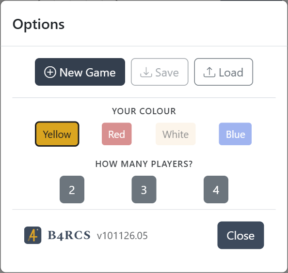

Tap **Options**, then **New Game**.

1. **Your colour:** you're always Player 1, but you can choose your colour. Whichever bot had that colour takes yours.
2. **Leaders & Lore:** turn on **Play with Leaders & Lore** to play with the mini expansion (see [Leaders & Lore](#leaders--lore)).
3. **How many players:** 2, 3 or 4, counting you. The app deals everyone's hands and, in a 2-player game, offers the mulligan. A random player starts with the initiative, as the rulebook says, and the ★ shows who.

 

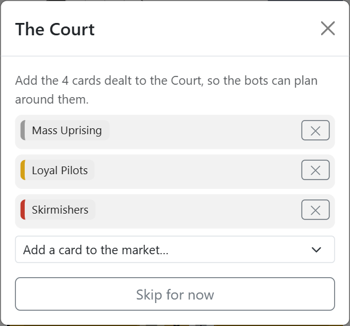

4. **The Court:** add the cards dealt to the Court market (4, or 3 with 2 players). Bots use this to choose what to secure and influence. You can skip it, but their advice will be more general.

 

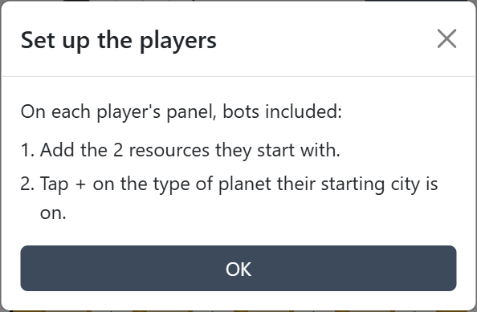

5. **Set up the players:** the setup list says where each player places their pieces, in turn order from whoever has the initiative. On each panel, add the 2 resources each player starts with, then tap **+** on the type of planet their starting city is on. With Leaders & Lore, the resources are filled in from each Leader, and the list says which pieces go in systems A, B and C.

 

## Leaders & Lore
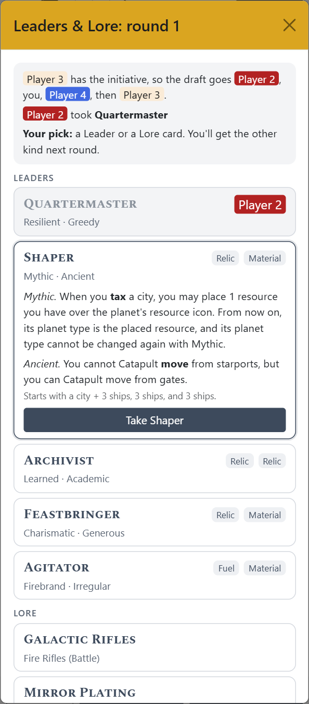

**The draft:** after the Court, everyone drafts as the rulebook says. There's a row of Leaders and a row of Lore cards, one more of each than there are players, and players pick in reverse turn order. You take one kind in the first round and the other kind in the second. Tap a card to read it, then **Take** it. The bots pick at random.

**Setting up:** the app sets each player up from their Leader: their starting resources, and what to place in systems A, B and C. An Archivist also chooses 2 extra Lore cards. Each player's Leader and Lore are shown above their Guild row. Tap one to read it.

 

**What the app does for you:**
- **Scoring:** the Elder, Warrior, Archivist and Noble score as their cards say, and the scoring window says why. The Fuel-Drinker discards its Fuel when Tycoon is scored.
- **Declaring:** when someone declares an ambition, the app carries out Ambitious (Upstart), Generous (Feastbringer), Bold (Demagogue) and Connected (Noble). When it's you, a window asks what you'd like to do. Bots do it themselves, and their turn window says what they did.
- **Securing:** a Demagogue can't secure a Guild card with only 1 of its agents on it.
- **Battles:** extra dice and dice limits (Rebel, Corsair, Raider Exosuits), raid limits (Hidden Harbors, Keeper's Trust, Keeper's Solidarity), intercepts (Agitator, Mirror Plating, Railgun Arrays) and no Ransack against the Elder. The results list anything else to do, such as repairs.
- **Ancient Holdings:** its extra resource slot is included when the app says which slot to put a resource in.

**How the bots use them:** a bot's plan has a short line under any step its Leader or Lore changes, such as *Rebel, Disorganized: no more than 2 ships at a time*. Bots lean towards the action their Leader improves when they Copy or Pivot, offer Lore actions in place of normal ones in a **Guild and Lore actions** window, and use Lore in their prelude, such as discarding a card to clear an Outrage.

**What's left to you:** anything that depends on the board, such as where Force Beams moves ships or which planet Mythic changes. The hints say what the bot may do. You decide where it makes sense.

## The screen
- **Top bar:** the round and turn, the ambitions declared this round with their marker values, and **Options**.
- **Player panels:** one per player in their colour. Tap a player's name to open or close their panel. The ★ shows who has the initiative.
- **Tiles:** each panel has **−** and **+** tiles for resources, Captives, Trophies, Power, ships on the board and cities on each planet type. Keep these matching the table. Bots use them to make their choices, and they're filled in for you when the app knows what happened, such as after a battle.
- **Guild row:** the Guild cards each player holds. Tap **+** to add one, or tap a card to read it or remove it.
- **Footer:** **Undo**, **Next Turn** and **Next Round**, with the cards played this turn listed above them.

## Your turn
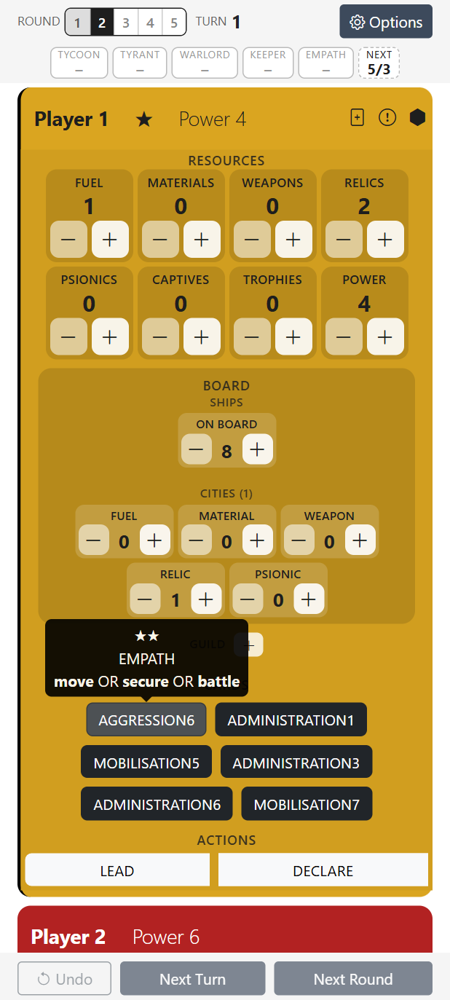

Your hand is listed on your panel. Tap a card to see its pips, ambition and actions, then choose how to play it:

- **Leading:** **LEAD**, or **DECLARE** to declare the ambition on it.
- **Following:** **SURPASS**, **COPY** or **PIVOT**.
- **CLAIM:** turn this on to also seize the initiative with a card played face down.

Then carry out your actions on the table and tap **Done**. While it's your turn, the **Battle** and **Court** icons on your panel help you keep track of a battle or the market (see below).

 

## A bot's turn
Tap the bot's **Play Card** button.

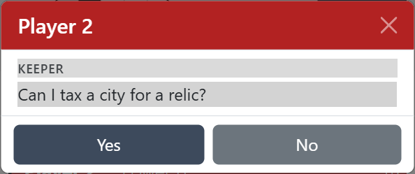

**Its questions:** if a bot is chasing an ambition, it may ask what it can do on the board, such as *"Can I tax a city for a relic?"* or *"Can I reach a Rival's relic city this turn, or get within one space of it?"*. Answer honestly from what you see on the table. It skips anything it can work out for itself.

 

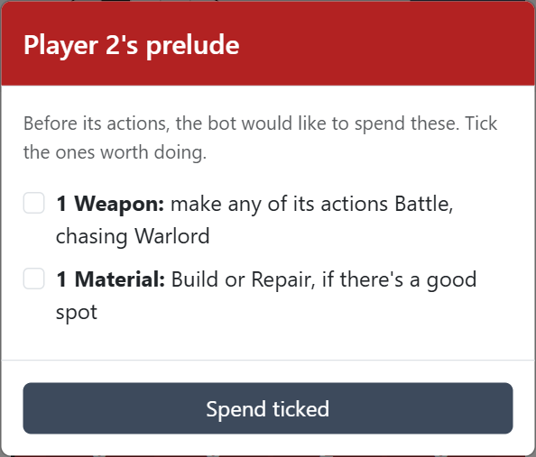

**Its prelude:** before its actions, a bot may offer to spend resources or use Guild cards. Tick the ones that make sense on the board. The app updates its resources for you.

 

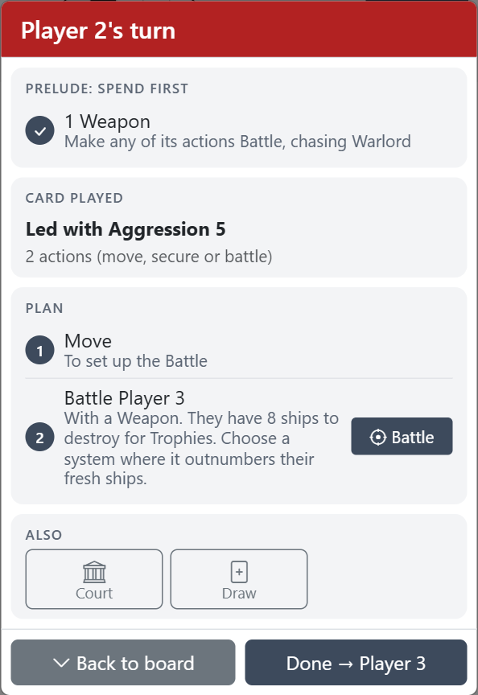

**The turn window** then shows the whole turn:

- **Prelude:** what it spent first.
- **Card played:** what it played, and the actions it gives.
- **Plan:** numbered steps with the reason for each, including who and where to battle and where to move. Steps that need a window have a button beside them, such as **Battle**, **Build** or **Court**. The plan is advice: see [The plan is advice](#the-plan-is-advice).
- **Also:** anything else it may use this turn.

Carry out the steps on the table, then tap **Done** to move on to the next player.

 

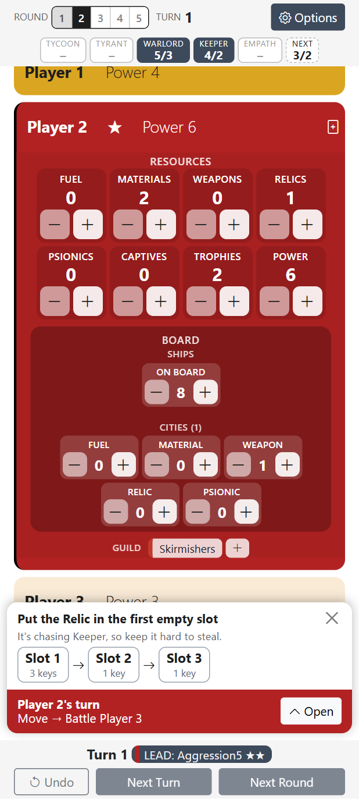

**Back to board** shrinks the window to a bar above the footer, so you can tap the tiles while still seeing the plan. Tap **Open** to bring the window back. It also comes back by itself when you finish a battle, build or Court action.

When a bot gains a resource, a box above the bar says **which resource slot to put it in**, high keys first if it wants to keep it safe from raids. It stays until you close it or the turn ends.

 

## What you handle for the bots
The app plays each bot's cards and makes its choices, but it can't see or touch the table. You're its eyes and hands:

- **Its pieces:** move its ships, and place or remove its buildings, agents and resources on the table. When the plan says something like *"a Rival's relic city"*, you choose which one.
- **Its panel:** keep its tiles matching the table. The app fills them in when it knows what happened, such as after a prelude, a battle, a build, the Court or scoring. For anything it can't see, such as a tax, you update the tiles.
- **Its answers:** answer its Yes/No questions from what you see on the table.
- **Its dice:** roll the dice it chooses, then enter what's left.
- **The Court:** when a card leaves the market, add its replacement. Do anything a window asks you to update yourself.

### The plan is advice
A bot plans its turn from what the app knows, and the app can't see the whole board. If a step doesn't make sense on the table, such as a battle it can't reach or a card that's no longer worth securing, skip it or use that action for something better. Play the bot the way a sensible player would.

The plan is set when the turn window opens and doesn't change as you work through it, so you can follow it step by step.

## Battles
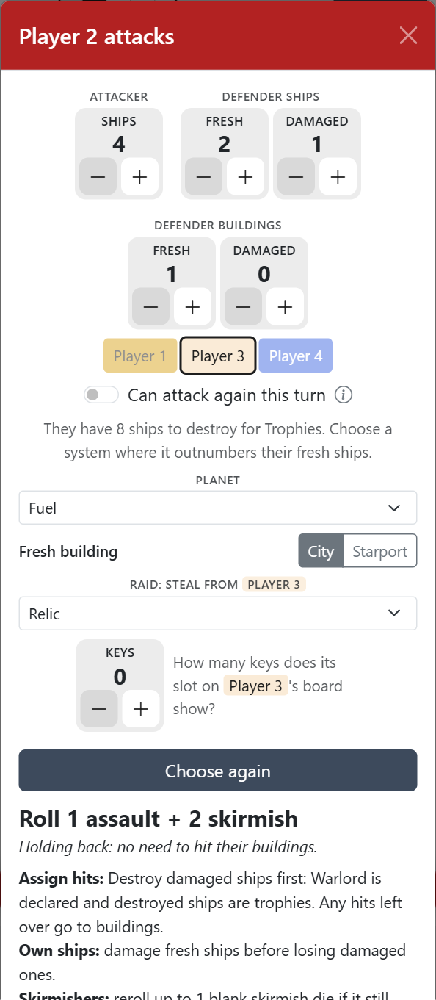

Tap **Battle** in the turn window, or the Battle icon on your own panel.

For a bot:
1. **Defender:** it starts on the Rival it wants to fight, and says why.
2. **Counts:** enter the ships and buildings in the system, the planet type, and whether each building is a city or a starport.
3. **Raid:** if the bot can raid, choose what it's after and enter the keys shown on that slot of the defender's board.
4. **Choose dice:** tells you which dice to roll and how to assign the hits. It weighs up the risk to its ships, what destroying a city would cost in Outrage, and any Ransack. **Details** shows the odds.
5. **After rolling:** set the counts to what's left. Attack again, or tap **Done battling**.

The **(i)** beside *Can attack again this turn* explains when to use that switch.

 

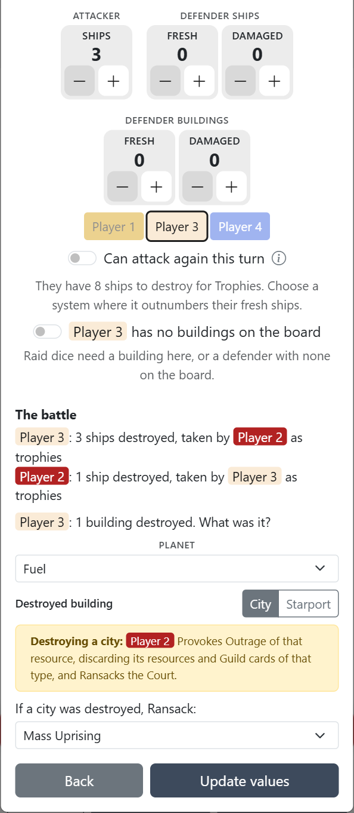

**Done battling** shows the results: ships destroyed and taken as Trophies, which buildings were destroyed, Outrage and Ransack, and anything stolen. Check them and tap **Update values** to update both players' panels.

For your own battles, the window doesn't choose dice. It keeps count while you roll, then updates the panels in the same way.

 

## Building
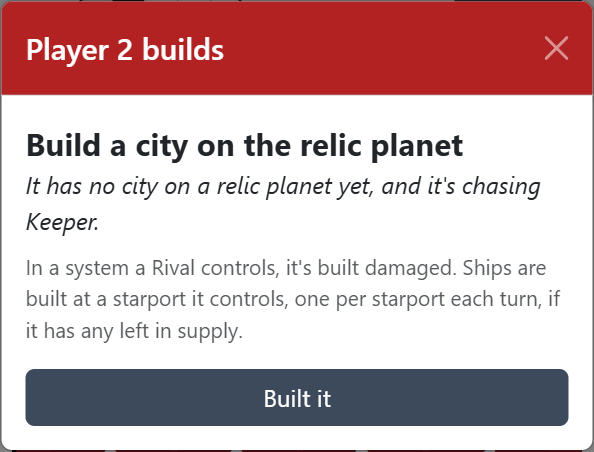

Tap **Build** in a bot's turn window. Say whether there's an empty building slot where it has a piece and which planet types those slots are on. The app tells you what it builds and why: a city, a starport or a ship. Tap **Built it** to update its panel.

 

## The Court
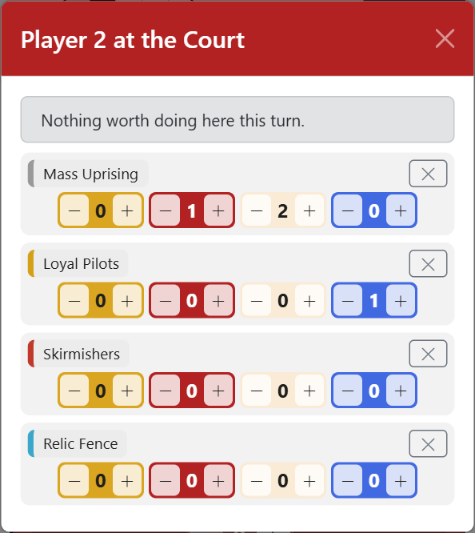

Tap **Court** in the turn window, or the Court icon on your own panel. It lists the cards in the market with everyone's agents on each in their colours. Use **−** and **+** to keep the agents up to date, **×** to remove a card, and the list at the bottom to add its replacement.

For a bot, the top line says what it would secure or influence. **Secure** takes a card the player can secure, captures any Rival agents on it, and moves it to their Guild row. When a bot secures a Vox card, the app tells you what it does with it.

If a card leaves the market, the turn window reminds you to add the replacement.

 

## Guild and Vox cards
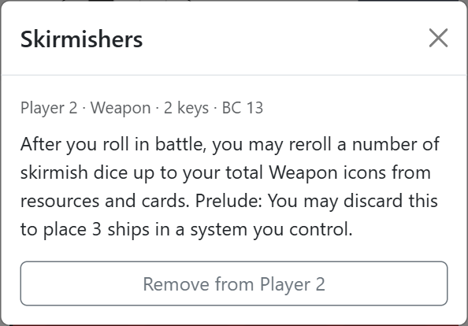

Tap a card in a player's Guild row to read it or remove it. Tap **+** to add one, which removes it from the market. For a bot, the list includes the Vox cards so you can record what it secured.

Bots use their Guild cards themselves: they offer them in their prelude or instead of actions, and they're included in battles, scoring and the cards they choose. Your **Farseers** card has a **Use its prelude** button, and when you declare with it, you choose one Rival's hand to look at and swap with.

 

## Drawing, declaring and seizing
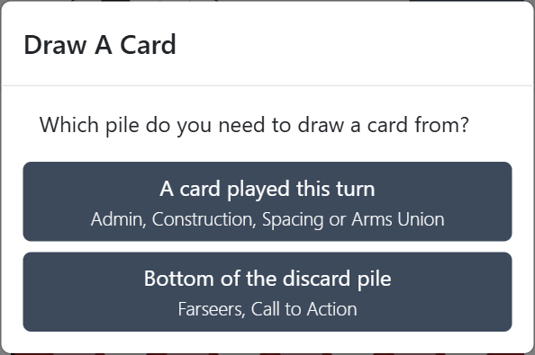

The icons on your panel's header are:

- **Draw:** add a card to a hand, either one played this turn (the Unions) or the bottom card of the discard pile (Farseers, Call to Action). Bots have this icon too.
- **Seize:** seize the initiative, for example with a Vox card.
- **Declare:** declare an ambition, for example after a Surpass with Galactic Bards.

Bots seize and declare by themselves.

 

## Ending a turn and a round
When everyone has played, tap **Next Turn**. When nobody has cards left, tap **Next Round**.

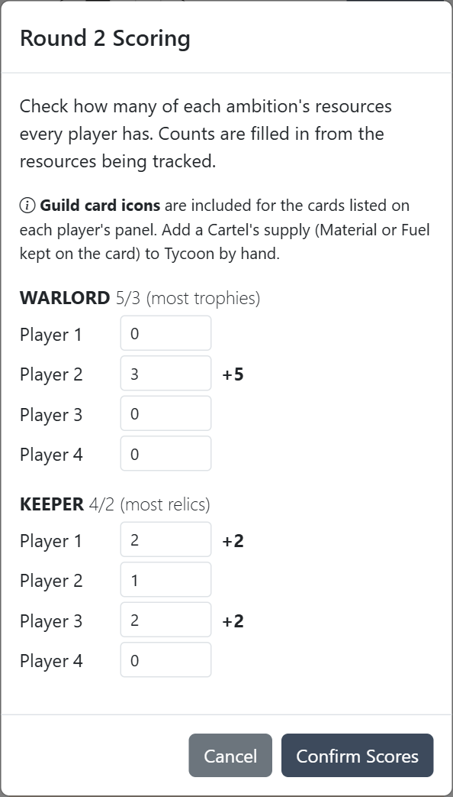

**Scoring** lists each declared ambition with every player's count, filled in from their panels, and the Power each would gain. Check the counts against the table and tap **Confirm Scores**. Trophies and Captives go back to their owners after Warlord and Tyrant are scored.

The game ends when someone reaches the Power target, or at the end of round 5, and the app shows who won.

 

## Undo, Save and Load
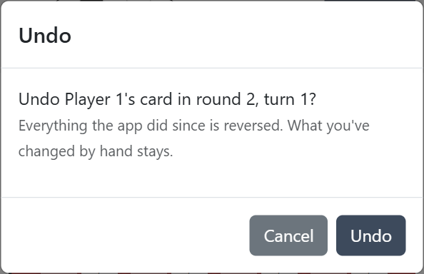

- **Undo:** in the footer. It takes back the last card played and everything the app did for it, but keeps anything you changed by hand since.
- **Save:** in **Options**. It downloads the game as a file.
- **Load:** also in **Options**. It opens a saved game, for example to carry on on another device.

 

---

Found a problem or have an idea? [Open an issue](https://github.com/OZ10/ARCS_Solo/issues).
